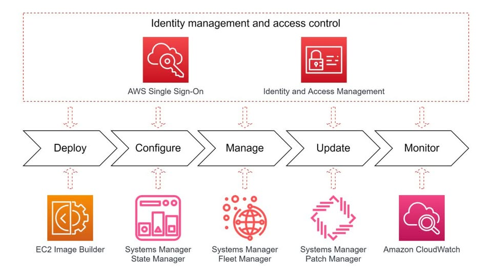

### WINDOWS SERVER FLEET GUARD: QUẢN TRỊ VÀ BẢO MẬT HẠ TẦNG WINDOWS QUY MÔ LỚN TRÊN AWS

**Đăng tại:** AWS Study Group (Facebook)

Một doanh nghiệp quản lý hàng trăm máy chủ Windows Server trên cả on-premises và AWS thường gặp khó khăn trong việc kiểm soát truy cập, duy trì cấu hình và cập nhật bản vá. Phụ thuộc vào RDP, bastion host hay thao tác thủ công trên từng máy vừa tốn thời gian vừa làm tăng rủi ro bảo mật. Bài viết tổng hợp cách AWS tự động hóa toàn bộ vòng đời Windows Server bằng AWS IAM Identity Center, EC2 Image Builder, AWS Systems Manager và Amazon CloudWatch.

**Các điểm chính cần nắm:**

- **Ba hạn chế của quản trị thủ công:** truy cập phụ thuộc RDP và bastion host làm tăng bề mặt tấn công; cấu hình thủ công gây configuration drift; vá từng máy riêng lẻ khiến xử lý lỗ hổng chậm.
- **Sáu thành phần chính:** IAM Identity Center và IAM (danh tính, SSO), EC2 Image Builder (chuẩn hóa AMI), State Manager (duy trì cấu hình bằng PowerShell DSC), Fleet Manager (quản lý và Remote Desktop qua trình duyệt), Patch Manager (quét và cài bản vá), CloudWatch (metric, Event Log, cảnh báo).
- **Tái sử dụng Group Policy:** có thể chuyển GPO hiện có sang PowerShell DSC bằng ConvertFrom-GPO, kể cả cho máy chủ không join domain.
- **Quy trình vận hành:** Image Builder tạo AMI đã tích hợp SSM Agent, CloudWatch Agent và cấu hình bảo mật STIG → State Manager áp dụng cấu hình theo Tag → kỹ sư đăng nhập bằng IAM Identity Center và mở Remote Desktop qua Fleet Manager, không cần mở cổng 3389 → Patch Manager cập nhật theo lịch bảo trì → CloudWatch giám sát.
- **Kiểm soát truy cập:** ABAC (phân quyền theo thuộc tính người dùng và máy chủ), AWS PrivateLink với VPC Endpoints (máy trong Private Subnet không cần Internet công cộng), Systems Manager Compliance (báo cáo cấu hình và bản vá).
- **Hạn chế cần lưu ý:** ứng dụng cũ dùng Kerberos hoặc NTLM vẫn có thể cần Active Directory; Patch Baseline có thể trì hoãn bản vá khẩn; CloudWatch Logs và VPC Endpoints tốn chi phí ở quy mô lớn; cấu hình hoặc bản vá lỗi có thể ảnh hưởng hàng loạt máy, nên cần chia nhóm Dev, Staging, Production.

**Kết luận và cảm nghĩ:**

Cốt lõi của giải pháp là mỗi giai đoạn trong vòng đời Windows Server được giao cho một dịch vụ riêng, và các dịch vụ nối với nhau thông qua Tag. Vì kỹ sư truy cập qua Fleet Manager nên không cần mở cổng 3389 ra Internet, và bề mặt tấn công nhỏ hơn. Tuy vậy giải pháp vẫn có giới hạn: ứng dụng cũ dùng Kerberos hoặc NTLM có thể vẫn cần Active Directory, và vì một cấu hình hay bản vá lỗi có thể ảnh hưởng hàng loạt máy, nên cần chia nhóm Dev, Staging, Production và kiểm thử trước khi đưa lên Production.

**Tài liệu tham khảo:**

1. AWS Blog: An AWS perspective on securely managing Windows Server infrastructure at scale.
2. AWS Security Blog: Enable secure seamless single sign-on to Amazon EC2 Windows instances with AWS SSO.
3. AWS Systems Manager User Guide: State Manager, Fleet Manager và Patch Manager.
4. AWS Systems Manager, Amazon EC2 Image Builder, Amazon CloudWatch.

**Link:** [Bài viết trên AWS Study Group](https://www.facebook.com/groups/660548818043427/?multi_permalinks=2339545870143705)
