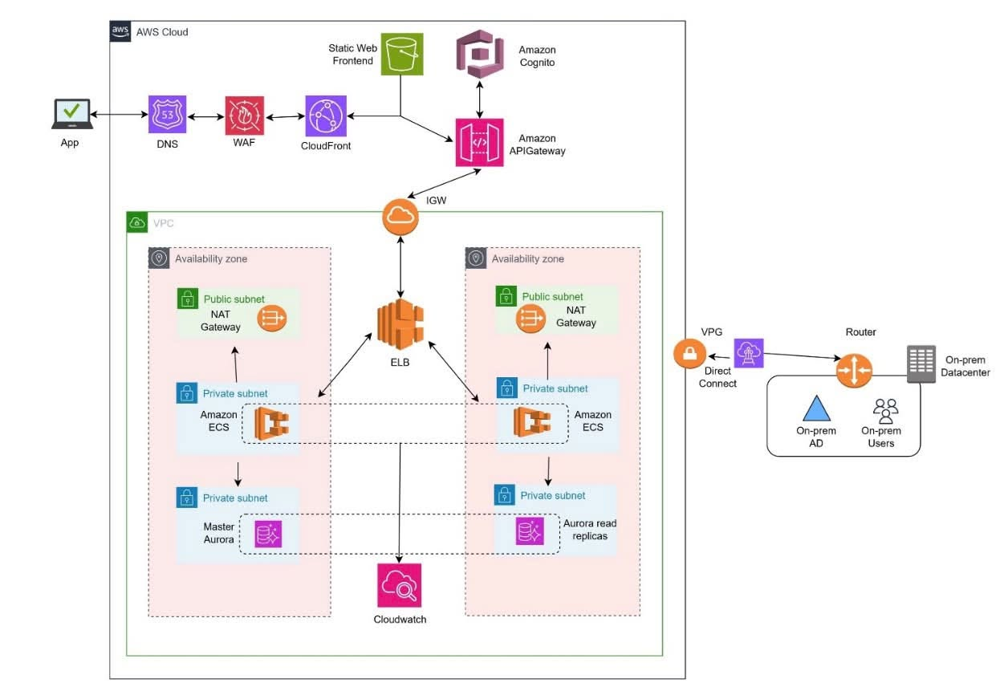

### CHUYỂN ĐỔI HỆ THỐNG MICROSOFT LÊN AWS: GIẢM 30% CHI PHÍ LICENSE VÀ 70% PHÍ LƯU TRỮ

**Đăng tại:** AWS Study Group (Facebook)

Đưa hệ thống .NET Framework và SQL Server cũ lên Cloud theo mô hình Lift-and-Shift, tức là chuyển nguyên trạng sang hạ tầng mới, chưa giải quyết được bài toán chi phí bản quyền và khả năng mở rộng. Bài viết này kể lại một ví dụ thực tế từ TEKsystems Global Services (TGS): hiện đại hóa toàn bộ nền tảng Microsoft của một trường đại học sang kiến trúc Cloud-Native trên AWS. Kết quả là chi phí bản quyền giảm 30% và chi phí lưu trữ giảm 70%.

**Các điểm chính cần nắm:**

- **Phân tích hệ thống trước khi sửa:** ứng dụng là một Monolith gồm 785.000 dòng code, 342 bảng dữ liệu và 63 Stored Procedures. Trước khi đụng vào code, đội ngũ chạy ba công cụ tự động. CAST Highlight tìm rủi ro trong mã nguồn và các rào cản khi chuyển lên Cloud. CAST Imaging vẽ ra luồng dữ liệu và quan hệ phụ thuộc giữa các thành phần, giúp giảm 80% thời gian phân tích. Babelfish Compass đánh giá mức độ chuyển được từ SQL Server (T-SQL) sang PostgreSQL.
- **Kết quả phân tích:** chỉ khoảng 20.000 trong số 785.000 dòng code nằm ở tầng Database, chưa tới 3% toàn bộ ứng dụng. Phần phụ thuộc vào SQL Server nhỏ như vậy nên việc thay thế nó khá thuận lợi.
- **Từ Monolith sang Microservices:** AWS Microservices Extractor for .NET phân tích ứng dụng rồi tách thành các dịch vụ độc lập, thay vì để mọi thứ nằm trong một khối.
- **Từ .NET Framework sang .NET 8:** Porting Assistant và AWS Transform for .NET hỗ trợ chuyển mã nguồn. Sau khi chuyển, ứng dụng chạy được trên Linux và AWS Graviton (Arm64).
- **Database và Storage:** SQL Server được thay bằng PostgreSQL, còn Amazon FSx được thay bằng Amazon S3. Đây là hai thay đổi liên quan trực tiếp đến hai khoản chi phí giảm được.
- **Kiến trúc mới theo AWS Well-Architected Framework:**
  - Amazon ECS chạy Linux Container cho phần tính toán.
  - Amazon ELB và Route 53 lo cân bằng tải và DNS.
  - Amazon S3 và CloudFront phân phối nội dung.
  - AWS WAF và Amazon Cognito lo bảo mật, Amazon API Gateway quản lý API.
  - Amazon CloudWatch theo dõi hệ thống.
  - AWS Organizations quản lý tập trung và lưu Audit Log.
- **Kết quả chi phí:** tiết kiệm 30% chi phí bản quyền thương mại và 70% chi phí lưu trữ.

**Kết luận và cảm nghĩ:**

Mức giảm 30% chi phí bản quyền và 70% chi phí lưu trữ đến từ việc phân tích hệ thống trước bằng các công cụ như CAST và Babelfish Compass, rồi mới chuyển từ .NET Framework sang .NET 8 chạy trên Linux, từ SQL Server sang PostgreSQL và từ Amazon FSx sang Amazon S3. Chỉ lift-and-shift thì hai khoản chi phí này vẫn giữ nguyên.

Điều mình để ý nhất là thứ tự làm việc. Con số 20.000 dòng code ở tầng Database chỉ có được sau bước phân tích, và chính con số đó cho đội ngũ biết việc bỏ SQL Server là khả thi. Nếu bỏ qua bước này, quyết định đổi database sẽ khó đưa ra. Mình cũng thấy bài viết cho thấy Cloud Modernization không dừng ở việc dời máy chủ lên Cloud: phải tái cấu trúc ứng dụng, chọn nền tảng phù hợp và tối ưu kiến trúc mới giảm được chi phí, tăng khả năng mở rộng và cải thiện hiệu quả vận hành.

**Tài liệu tham khảo:**

1. AWS Blog: How TEKsystems modernized a university's Microsoft workloads on AWS — [aws.amazon.com/blogs/modernizing-with-aws](https://aws.amazon.com/blogs/modernizing-with-aws/how-teksystems-modernized-a-universitys-microsoft-workloads-on-aws)
2. AWS Transform for .NET (AWS Documentation, User Guide).
3. AWS Microservices Extractor for .NET (AWS Documentation).
4. Modernize Windows Workloads — [aws.amazon.com/vi/transform/windows](https://aws.amazon.com/vi/transform/windows/)

**Link:** [Bài viết trên AWS Study Group](https://www.facebook.com/groups/660548818043427/?multi_permalinks=2340011250097167)
