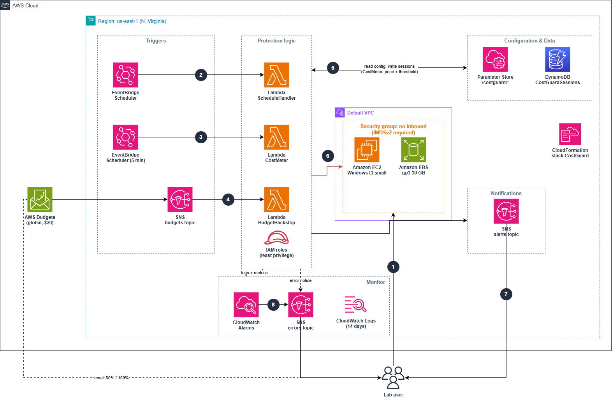

### COST GUARD: 3 LỚP SERVERLESS TỰ TẮT MÁY WINDOWS ĐỂ GIỮ CREDIT AWS FREE PLAN

**Đăng tại:** AWS Study Group (Facebook)

Nhóm mình (AwsAILearner67, FCAJ) làm lab trên một tài khoản AWS Free Plan dùng chung, credit có hạn. Vấn đề hay gặp nhất không nằm ở kỹ thuật mà là con người: học xong quên tắt máy. Một máy Windows `t3.small` chạy 24/7 tốn khoảng **$31.04 mỗi tháng** (EC2 $28.62 + ổ EBS $2.40), vượt luôn ngân sách $20 của cả dự án.

AWS Budgets gửi được email cảnh báo, nhưng có hai hạn chế: dữ liệu billing chỉ cập nhật vài lần mỗi ngày, và Budgets không tự tắt máy. Nên nhóm làm **Cost Guard**: 3 lớp độc lập cùng canh một máy, lớp này hỏng thì vẫn còn hai lớp kia.

**3 lớp bảo vệ:**

- **Lớp 1 – Tắt theo lịch:** EventBridge Scheduler gọi Lambda `CostGuard-ScheduleHandler` lúc 22:00 mỗi ngày, theo múi giờ `Asia/Ho_Chi_Minh`. Máy đang chạy thì hàm gọi `StopInstances`, máy đã tắt thì chỉ ghi lại `schedule_noop`. Lớp này không cần dữ liệu billing nên chắc chắn nhất. Nhóm cố ý không tự bật máy: ai cần học thì tự bật, để không tốn tiền lúc không ai dùng.
- **Lớp 2 – Đồng hồ đo tiền (phần tự làm của nhóm):** cứ 5 phút, Lambda `CostGuard-CostMeter` kiểm tra máy. Máy đang chạy thì hàm cộng chi phí của 5 phút đó ($0.0392/giờ × 5/60 ≈ $0.0033) vào tổng của tháng và lưu một bản ghi vào DynamoDB. Tổng chạm ngưỡng $14 thì tắt máy và gửi email qua SNS. Không phải chờ billing nên phản ứng trong vài phút.
- **Lớp 3 – Lưới an toàn cuối:** AWS Budgets $20 báo ở mức 80% và 100% chi tiêu thật. Budgets đẩy thông báo vào SNS topic `costguard-budgets`, topic này gọi Lambda `CostGuard-BudgetBackstop` để tắt máy và gửi email xác nhận. Billing chậm nên lớp này chỉ là phương án cuối.

Ngoài ra, CloudWatch alarm canh lỗi của cả 3 hàm Lambda và gửi email qua topic riêng `costguard-errors`. Lớp nào lỗi thì nhóm biết ngay, không đợi tới lúc hết credit.

**Vì sao ngưỡng là $14:** ngưỡng của Lớp 2 đặt khoảng 70% ngân sách. Với $0.0392/giờ, $14 tương đương khoảng 357 giờ chạy, dư xa so với kế hoạch 120 giờ lab mỗi tháng. Khoảng trống $6 còn lại dành cho độ trễ billing của Lớp 3. Đơn giá, ngưỡng và instance ID đều để trong Parameter Store chứ không viết cứng trong code, muốn dùng cho máy khác thì chỉ cần đổi giá trị.

**Kết quả test thật (us-east-1, 22 và 25/11/2026):**

| Lớp | Cách test | Kết quả |
|---|---|---|
| 1 | Gọi thẳng hàm khi máy đang chạy | Máy tắt sau 3 giây |
| 2 | Hạ ngưỡng xuống `0.001` rồi chờ lần chạy kế tiếp | CostMeter tắt máy 3 phút 47 giây sau khi lưu ngưỡng (theo CloudTrail) |
| 3 | Gửi tin thử lên topic `costguard-budgets` | Máy tắt sau 7 giây |

Cả 3 lần đều có bản ghi trong DynamoDB (`schedule_stop`, `auto_stop`, `budget_stop`) và email về hộp thư nhóm. Test xong nhớ trả ngưỡng về 14.

**Chi phí:** theo AWS Pricing Calculator, với 120 giờ lab mỗi tháng: EC2 $4.70 + EBS $2.40 + Lambda $0.02 = **$7.12/tháng**. Cộng IPv4 công khai, CloudWatch và các dịch vụ khác thì khoảng $8.05. So với $31.04 nếu để máy chạy suốt, Cost Guard tiết kiệm khoảng $23.92 mỗi tháng (~77%). Phần "bảo vệ" (Lambda, DynamoDB on-demand, SNS, Scheduler, Parameter Store) gần như bằng 0.

**Kết luận và cảm nghĩ:**

- Bảo vệ chi phí nên có nhiều lớp: một lớp dựa vào giờ giấc, một lớp dựa vào ước tính, một lớp dựa vào bill thật. Lớp này bù cho điểm yếu của lớp kia.
- Mỗi hàm Lambda có IAM role riêng, quyền `StopInstances` chỉ áp lên đúng máy lab. Lỡ cấu hình sai cũng không tắt nhầm máy của người khác.
- Máy lab không mở cổng inbound nào và bắt buộc IMDSv2.
- Toàn bộ nằm trong một CloudFormation template, xoá stack là dọn gần hết. Khi dọn thật, nhóm vẫn phải xoá tay 2 thứ tạo ngoài stack: IAM role do console Scheduler tự tạo và bucket `cf-templates` chứa file template đã upload.

Workshop đầy đủ (từng bước, ảnh, template): [nguyenducbinh-aws.github.io/AwsAILearner67](https://nguyenducbinh-aws.github.io/AwsAILearner67/)

**Tham khảo:**

- [EventBridge Scheduler: schedule types và time zone](https://docs.aws.amazon.com/scheduler/latest/UserGuide/schedule-types.html)
- [AWS Budgets](https://docs.aws.amazon.com/cost-management/latest/userguide/budgets-managing-costs.html)
- [AWS Pricing Calculator](https://calculator.aws/)

**Link:** [Bài viết trên AWS Study Group](https://www.facebook.com/groups/awsstudygroupfcj/posts/2350545079043784/)
