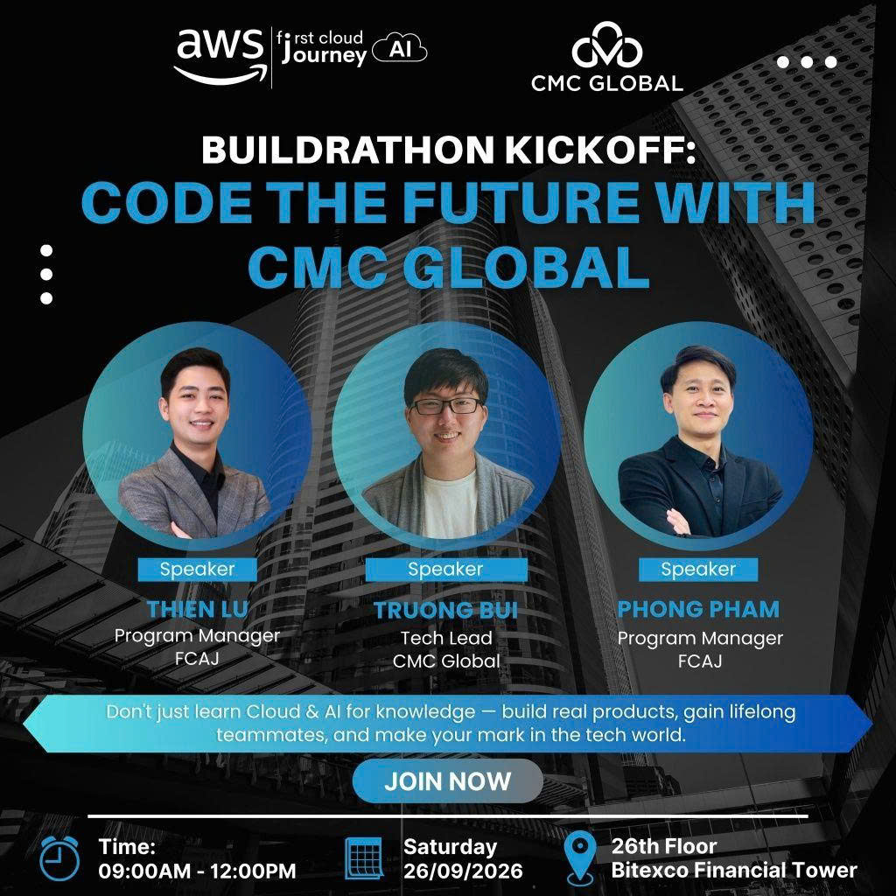
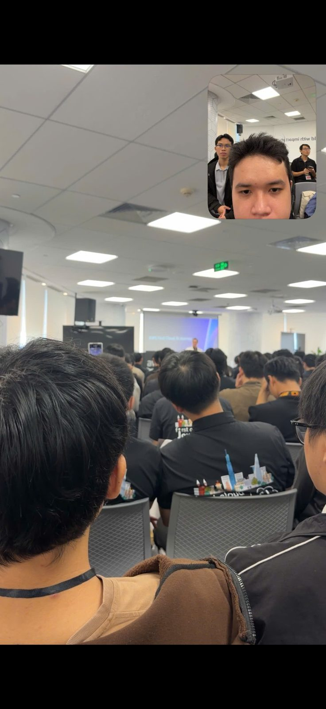
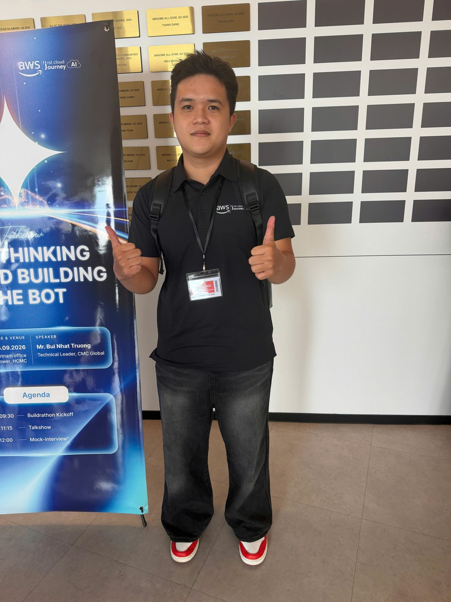

**Thời gian:** Thứ Bảy 26/09/2026, 09:00–12:00 · **Địa điểm:** Văn phòng AWS, tầng 26 Bitexco, TP. Hồ Chí Minh · **Vai trò:** Người tham dự

### Mục tiêu sự kiện

Buổi kickoff mở đầu Season 01 của FCAJ Buildrathon 2026, sáu tháng thử thách về Cloud và AI dành cho thực tập sinh. CMC Global và VietAWS tham gia với một talkshow về làm bot cho doanh nghiệp thật và các buổi trao đổi nghề nghiệp 1-1.

### Diễn giả

- Thien Lu — Program Manager, FCAJ
- Truong Bui — Tech Lead, CMC Global
- Phong Pham — Program Manager, FCAJ
- Đội Tuyển dụng CMC Global — tư vấn nghề nghiệp, trao đổi 1-1

### Nội dung chính

| Thời gian | Phần |
|---|---|
| 09:00–09:30 | Khai mạc Buildrathon |
| 09:30–11:15 | Talkshow "The Thinking Behind Building The Bot" |
| 11:15–12:00 | Phỏng vấn thử và trao đổi nghề nghiệp 1-1 |

Cuối buổi có quay số may mắn, phần quà là bộ bàn phím và chuột Logitech.

### Điều mình học được

- Các diễn giả nhắc đi nhắc lại một thứ tự: thống nhất bài toán và luồng dữ liệu trước, rồi mới viết code. Bot chỉ "chạy được" thì chưa xong, vì còn chi phí và an toàn.
- Phần phân tích bài test thật cho mình thấy chia nhỏ yêu cầu đã là phần lớn công việc.
- Buổi trao đổi nghề nghiệp nói rõ: nhà tuyển dụng quan tâm thứ mình đã làm và giải thích được, không phải danh sách dịch vụ mình từng nghe tên.

### Áp dụng vào công việc / dự án Cost Guard

Dự án của nhóm không phải bot, nhưng thứ tự này vẫn có ích. Trước khi viết Lambda nào, nhóm thống nhất ba lớp: tắt máy hằng ngày lúc 22:00, đồng hồ đo chi phí mỗi 5 phút, và lớp chặn cuối bằng Budgets. Sau đó mình làm phần nền và Layer 1 trước, vì các lớp còn lại đều dựa vào đó. Ý về chi phí cũng rất sát: Cost Guard sinh ra để giữ credit Free Plan, nên mình kiểm tra giá của từng dịch vụ trước khi thêm vào.

### Ảnh check-in

