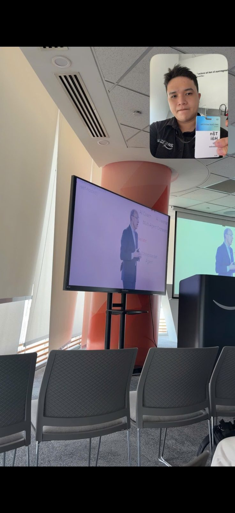
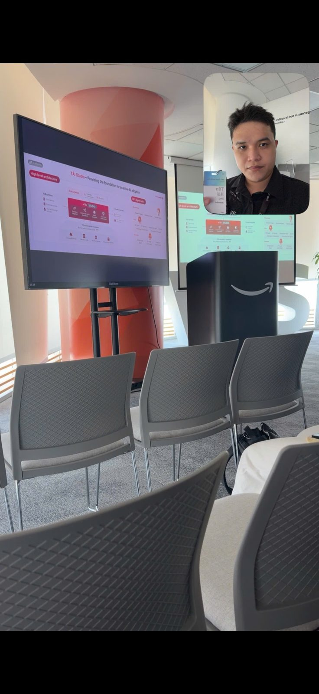
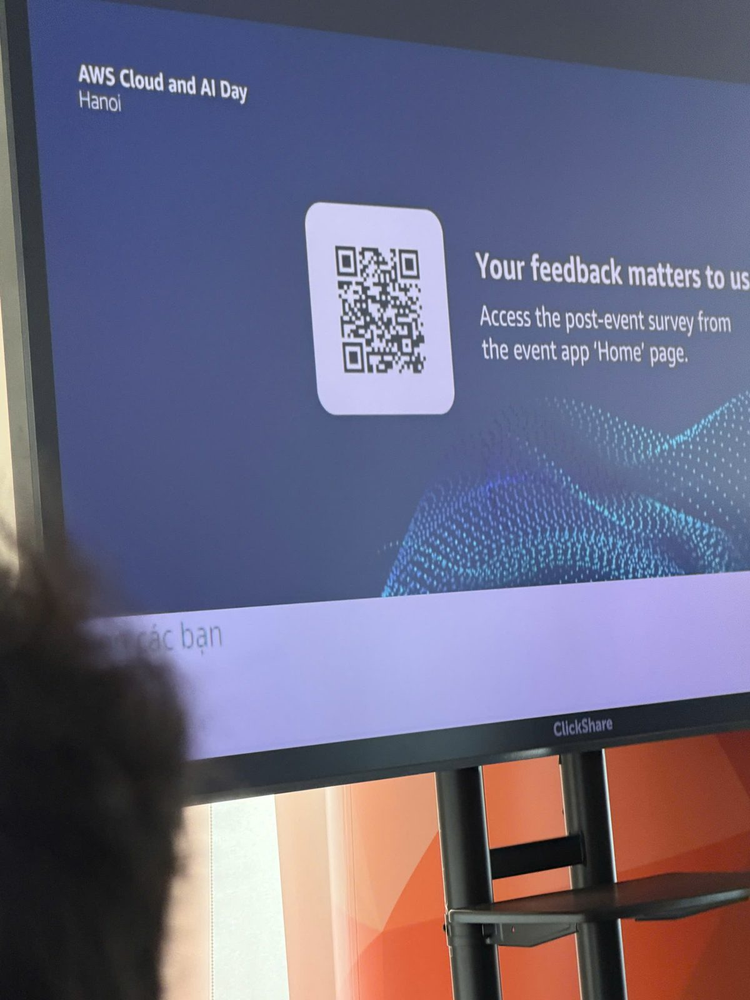

**Thời gian:** Thứ Ba 29/09/2026, 08:30–17:00 · **Địa điểm:** Văn phòng AWS, tầng 26 Bitexco, TP. Hồ Chí Minh (phát trực tiếp từ sân khấu chính ở Hà Nội) · **Vai trò:** Người tham dự

### Mục tiêu sự kiện

Sự kiện Cloud và AI lớn nhất trong năm của AWS tại Việt Nam. Văn phòng ở TP.HCM tổ chức Watch Party để người ở phía Nam xem trực tiếp các keynote và gặp cộng đồng tại chỗ. Chủ đề chính là Agentic AI, kèm theo bảo mật, kiểm thử và quản trị AI.

### Diễn giả

- Dr. Werner Vogels — CTO, Amazon.com
- Dr. Jens Lottner — CEO, Techcombank
- Mai Le — Director of Product Management, Katalon
- Võ Xuân Minh Tuấn — Senior Solution Architect, AWS
- Đại diện Bộ Khoa học và Công nghệ, AWS và các đối tác

### Nội dung chính

- **Invisible Engineering (Werner Vogels):** câu chuyện phía sau Dynamo, Nitro, và Lambda với Firecracker, SnapStart.
- **Agentic AI ở Techcombank:** AI để giúp nhân viên mạnh hơn, đi kèm ROI, guardrail và giám sát.
- **Kiểm thử thời GenAI (Katalon):** code được viết nhanh hơn tốc độ kiểm tra; AI làm, con người đặt giới hạn.
- **AI security agent và quản trị AI với Amazon Q:** rà thiết kế, quét code, kiểm soát "shadow AI".
- **Câu chuyện khách hàng:** Vinasoy, Agris, AMI Group và một số ngân hàng.

### Điều mình học được

- Serverless không phải phép màu. Câu chuyện Lambda cho mình thấy có rất nhiều kỹ thuật nằm dưới một dịch vụ mà mình chỉ gọi bằng vài dòng code.
- Nhiều phần trình bày nói cùng một ý từ các góc khác nhau: khi tự động hóa, con người vẫn phải quyết định giới hạn và kiểm tra kết quả.
- Kiểm thử và bảo mật phải có ở mọi bước, không để đến cuối.

### Áp dụng vào công việc / dự án Cost Guard

Cost Guard là tự động hóa tắt máy của người khác, nên ý "con người đặt giới hạn" rất quan trọng với mình. Giờ tắt máy, các ngưỡng chi phí và email cảnh báo đều là cấu hình người dùng chỉnh qua Parameter Store và SNS, không giấu trong code. Thông điệp về kiểm thử là lý do sau này mình kiểm tra lại toàn bộ stack từ đầu đến cuối: bật instance, chờ từng lớp kích hoạt, và xem email cảnh báo có tới không. Mình không coi một lớp là chạy đúng chỉ vì nó deploy thành công.

### Ảnh check-in

