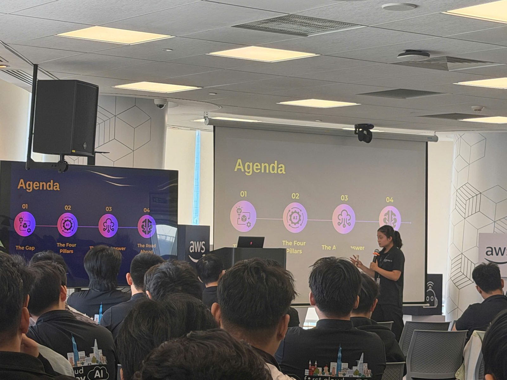
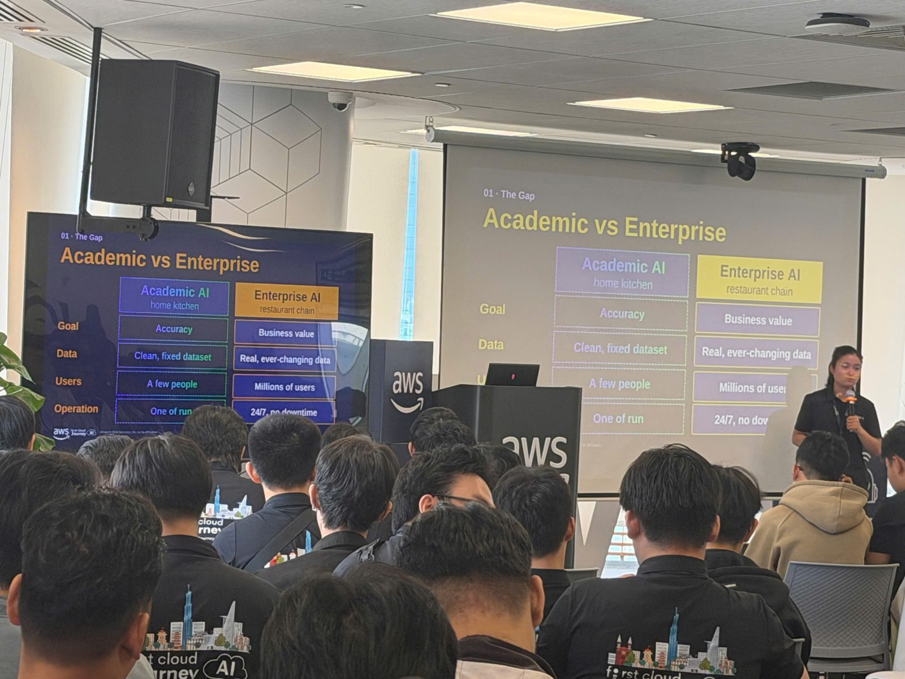
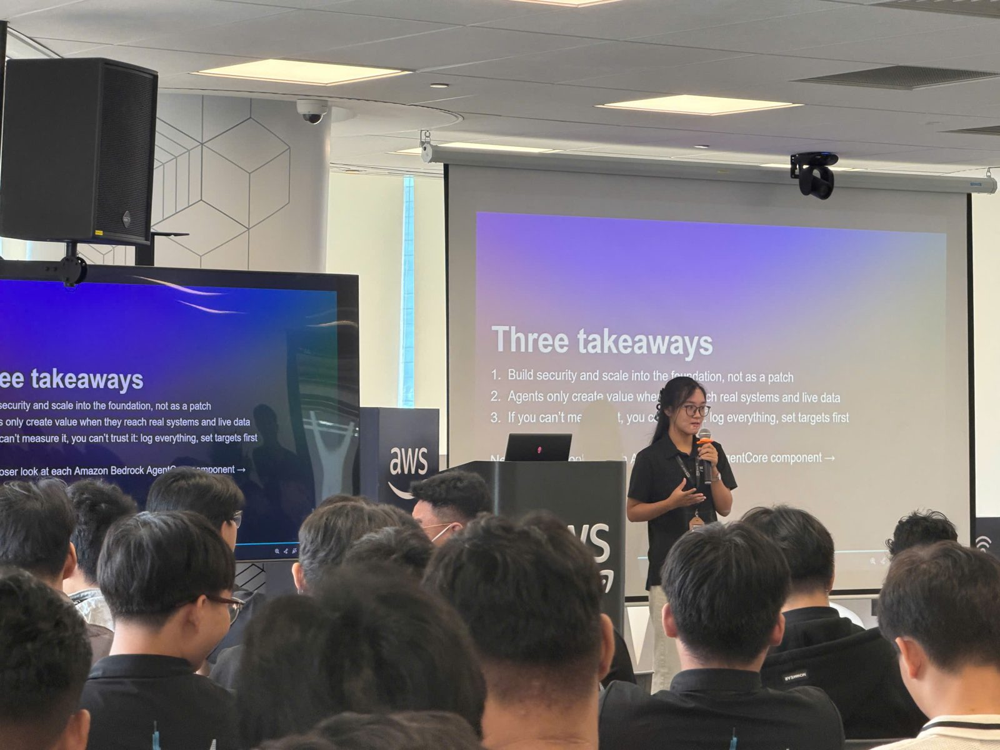
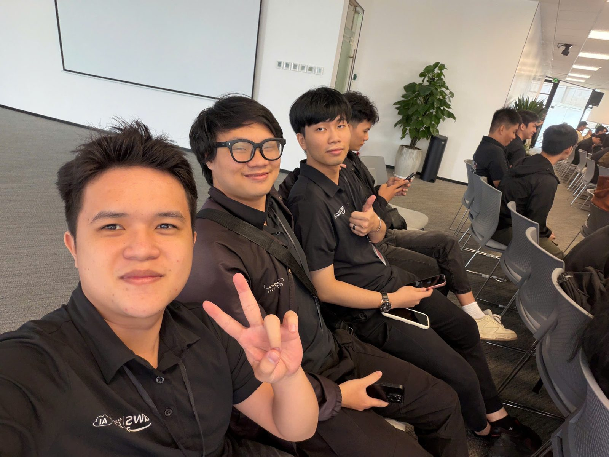

**Thời gian:** Thứ Bảy 14/11/2026 · **Địa điểm:** Văn phòng AWS, tầng 26 Bitexco, TP. Hồ Chí Minh · **Vai trò:** Người tham dự

### Mục tiêu sự kiện

Buổi chia sẻ của FCAJ cho thực tập sinh về cách đưa một AI agent từ bản thử lên production trên AWS bằng Amazon Bedrock AgentCore, sao cho an toàn, ổn định và mở rộng được ngay từ đầu.

### Nội dung chính

- Vì sao AI trong học thuật và AI trong doanh nghiệp là hai bài toán khác nhau.
- AgentCore kiểm soát ai được gọi agent và agent được gọi tới đâu.
- Ba ý cần nhớ khi chạy agent ở production.

### Điều mình học được

- Bài AgentCore mở đầu bằng so sánh "Academic vs Enterprise". AI trong học thuật nhắm tới độ chính xác, dữ liệu sạch và cố định, vài người dùng. AI trong doanh nghiệp nhắm tới giá trị kinh doanh, dữ liệu thật và luôn thay đổi, rất nhiều người dùng và chạy liên tục.
- AgentCore tách riêng chiều vào và chiều ra: ai được gọi agent là một câu hỏi, agent được gọi tới đâu là câu hỏi khác, mỗi chiều có lớp kiểm soát riêng.
- Bài kết thúc bằng ba ý mình ghi lại: đưa bảo mật và khả năng mở rộng vào phần nền ngay từ đầu, không vá sau; agent chỉ tạo ra giá trị khi chạm tới hệ thống thật và dữ liệu thật; không đo được thì không tin được, nên phải ghi log mọi thứ và đặt mục tiêu trước.

### Áp dụng vào công việc / dự án Cost Guard

Ý thứ ba rất gần với cách Cost Guard chạy. Mỗi lớp đều ghi lại việc đã làm vào bảng DynamoDB (`schedule_stop`, `threshold_stop`, `budget_stop`) và ghi log ra CloudWatch, còn mục tiêu được viết ra trước khi test: bộ đo phải tắt máy trong vòng một chu kỳ 5 phút. Khi kiểm tra lại stack, mình so thời gian phản ứng thật với mục tiêu đó, chứ không chỉ xem máy có tắt hay không. Ý thứ nhất cũng khớp với việc nhóm cho mỗi Lambda một role riêng ngay từ template đầu tiên, thay vì thêm quyền về sau.

### Ảnh check-in

