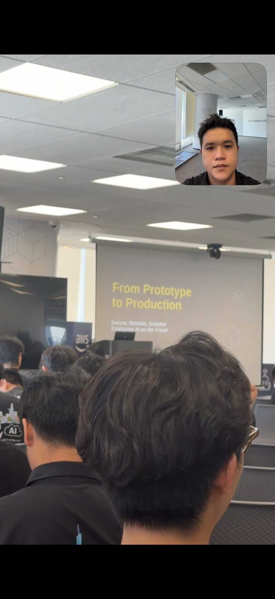
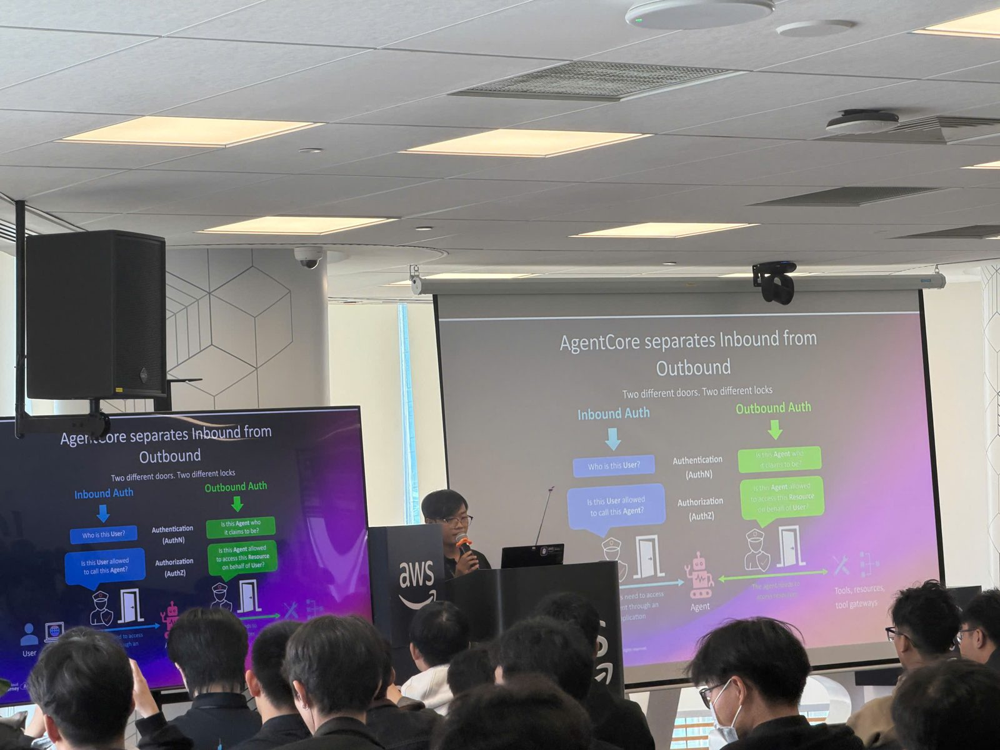

**Thời gian:** Thứ Bảy 24/10/2026, 09:00–12:00 · **Địa điểm:** Văn phòng AWS, tầng 26 Bitexco, TP. Hồ Chí Minh · **Vai trò:** Người tham dự

### Mục tiêu sự kiện

Buổi gặp mặt ba tiếng của FCAJ dành cho thực tập sinh, xoay quanh việc đưa hệ thống AI và cloud từ ý tưởng tới lúc chạy thật: voice AI, chia sẻ tài nguyên giữa các account, kiểm thử bảo mật, đưa AI agent lên production và giữ một agent chạy suốt ngày đêm.

### Diễn giả

- Kiet Tran (Revve AI): xây tổng đài voice AI tiếng Việt trên AWS
- Long Huynh (Styl Solution): AWS Resource Access Manager
- Thinh Nguyen (Styl Solution): kiểm thử bảo mật với AWS Security Agent
- Xuan An (trưởng AWS Student Builder Group HCMUTE): Amazon Bedrock AgentCore
- Khoa Kieu (ACB) và Nghi Danh (AWS Community Builder): Kiro Crew

### Nội dung chính

| Phiên | Chủ đề |
|---|---|
| 1 | Hear, Think, Speak: tổng đài voice AI trên AWS, có demo phỏng vấn qua điện thoại |
| 2 | AWS Resource Access Manager: chia sẻ tài nguyên giữa các account thay vì sao chép |
| 3 | AWS Security Agent: rà code hạ tầng và kiểm thử tự động trước khi phát hành |
| 4 | Amazon Bedrock AgentCore: từ prototype tới production |
| 5 | Kiro Crew: AI agent chạy 24/7, có giới hạn về context, bộ nhớ và quyền |

### Điều mình học được

- Bài AgentCore mở đầu bằng so sánh "Academic vs Enterprise". AI trong học thuật nhắm tới độ chính xác, dữ liệu sạch và cố định, vài người dùng. AI trong doanh nghiệp nhắm tới giá trị kinh doanh, dữ liệu thật và luôn thay đổi, rất nhiều người dùng và chạy liên tục.
- AgentCore tách riêng chiều vào và chiều ra: ai được gọi agent là một câu hỏi, agent được gọi tới đâu là câu hỏi khác, mỗi chiều có lớp kiểm soát riêng.
- Bài kết thúc bằng ba ý mình ghi lại: đưa bảo mật và khả năng mở rộng vào phần nền ngay từ đầu, không vá sau; agent chỉ tạo ra giá trị khi chạm tới hệ thống thật và dữ liệu thật; không đo được thì không tin được, nên phải ghi log mọi thứ và đặt mục tiêu trước.
- Phiên voice AI cho thấy độ trễ quyết định trải nghiệm: mỗi bước thêm vào (giọng nói thành chữ, mô hình, chữ thành giọng nói) đều cộng thêm độ trễ mà người nghe cảm nhận được.

### Áp dụng vào công việc / dự án Cost Guard

Ý thứ ba rất gần với cách Cost Guard chạy. Mỗi lớp đều ghi lại việc đã làm vào bảng DynamoDB (`schedule_stop`, `threshold_stop`, `budget_stop`) và ghi log ra CloudWatch, còn mục tiêu được viết ra trước khi test: bộ đo phải tắt máy trong vòng một chu kỳ 5 phút. Khi kiểm tra lại stack, mình so thời gian phản ứng thật với mục tiêu đó, chứ không chỉ xem máy có tắt hay không. Ý thứ nhất cũng khớp với việc nhóm cho mỗi Lambda một role riêng ngay từ template đầu tiên, thay vì thêm quyền về sau.

### Ảnh check-in

