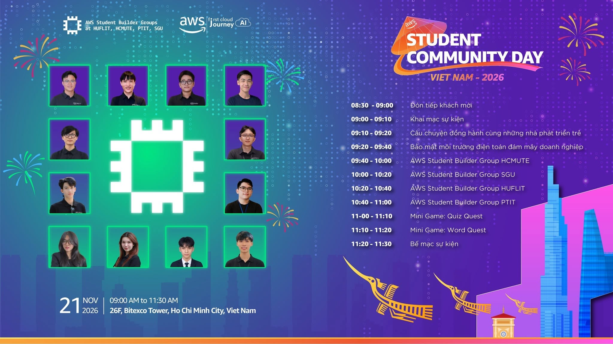
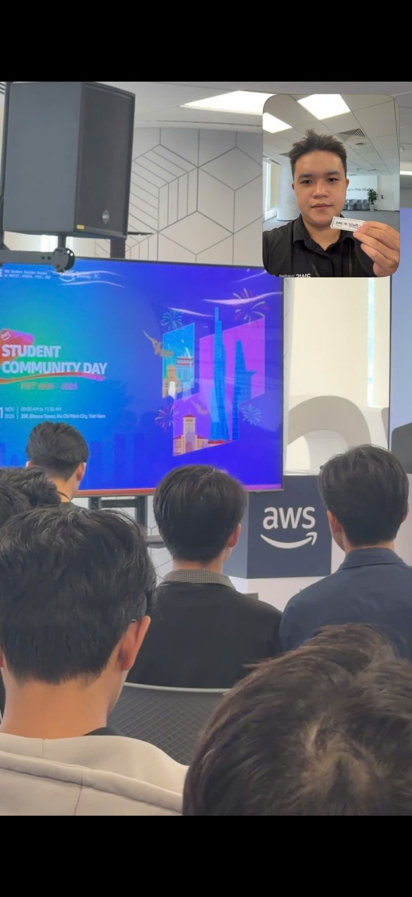
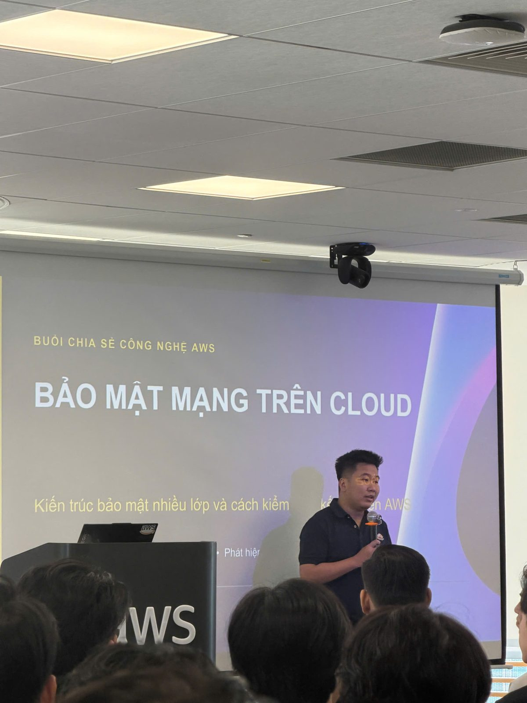
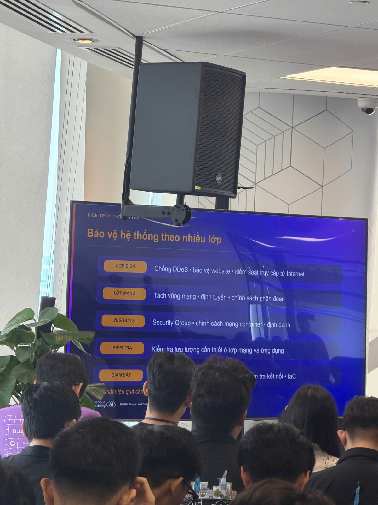
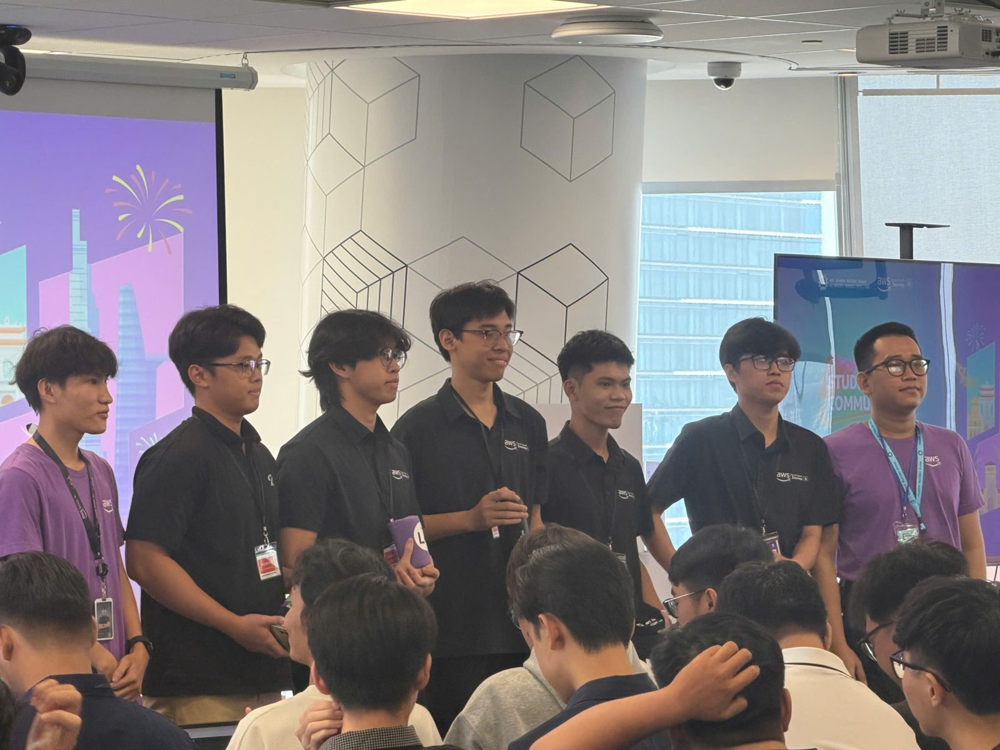
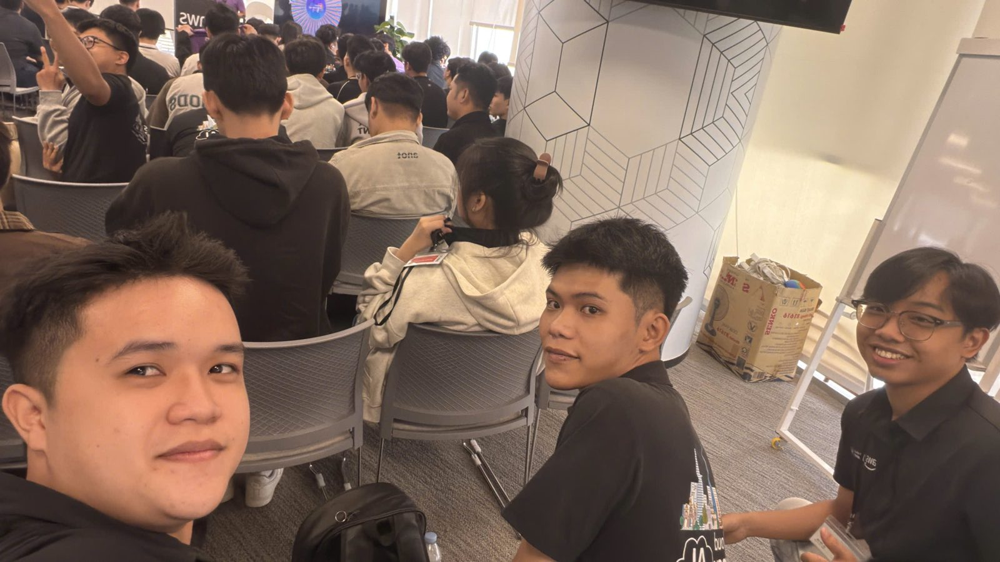

**Thời gian:** Thứ Bảy 21/11/2026, 08:30–11:30 · **Địa điểm:** Văn phòng AWS, tầng 26 Bitexco, TP. Hồ Chí Minh · **Vai trò:** Người tham dự

### Mục tiêu sự kiện

Một buổi sáng nói về Cloud và AI do sinh viên tự tổ chức, gồm bốn AWS Student Builder Group (HUFLIT, HCMUTE, PTIT HCM, SGU) trong khuôn khổ FCAJ. Mục tiêu là nghe chuyên gia chia sẻ, để các nhóm sinh viên trình bày, và kết nối builder giữa các trường.

### Diễn giả

- Hai phần chia sẻ của chuyên gia: "Journeying with Young Builders" và "Enterprise Cloud Environment Security"
- Đại diện Student Builder Group của HCMUTE, SGU, HUFLIT và PTIT

### Nội dung chính

| Thời gian | Phần |
|---|---|
| 08:30–09:00 | Check-in |
| 09:00–09:10 | Khai mạc |
| 09:10–09:20 | Journeying with Young Builders |
| 09:20–09:40 | Enterprise Cloud Environment Security |
| 09:40–11:00 | Bốn bài trình bày của các Student Builder Group (mỗi bài 20 phút) |
| 11:00–11:20 | Mini game Quiz Quest và Word Quest |
| 11:20–11:30 | Bế mạc |

### Điều mình học được

- Bài "Bảo mật mạng trên Cloud" chia việc bảo vệ hệ thống theo lớp: lớp biên (chống DDoS, bảo vệ website, kiểm soát truy cập từ Internet), lớp mạng (tách vùng, định tuyến, chính sách phân đoạn), lớp ứng dụng (Security Group, chính sách mạng container, định danh), và kiểm tra lưu lượng cần thiết ở lớp mạng và ứng dụng.
- Các Student Builder Group khép lại bằng ba cách tham gia: Learn, Build và Connect.
- Phần quiz cho mình thấy còn nhiều dịch vụ AWS mà nếu bị hỏi, mình chưa giải thích được.

### Áp dụng vào công việc / dự án Cost Guard

Mình xem lại các IAM role trong template CloudFormation của nhóm. Mỗi Lambda có role riêng, và hàm tắt máy chỉ được stop instance, không được terminate. Cách chia lớp của bài bảo mật cũng khớp với máy lab của nhóm: security group không mở inbound nào nên không có gì từ Internet vào được máy, và bắt buộc IMDSv2. Với buổi demo cuối, mình muốn giữ khuôn 20 phút như các nhóm sinh viên: một sơ đồ kiến trúc, ba lớp theo thứ tự, rồi tắt máy trực tiếp.

### Ảnh check-in

