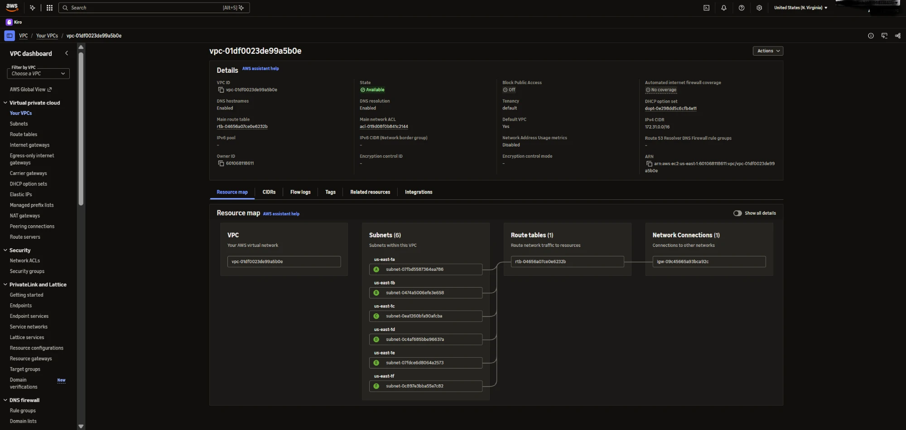

## Các bước chuẩn bị

Chuẩn bị các mục dưới đây trước khi bắt đầu. Toàn bộ workshop chạy trong một region: **US East (N. Virginia), `us-east-1`**.

### 1. Tài khoản AWS và quyền truy cập

- Một tài khoản AWS còn đủ credit. Chi phí ước tính của workshop là khoảng **$8.05** (xem mục 5.7), nên hãy để trống ít nhất $20 credit.
- Một **IAM user** để đăng nhập. Không dùng root user. Trong tài khoản lab riêng, gắn policy `AdministratorAccess` cho user này là cách đơn giản nhất. User cần tạo được CloudFormation stack, IAM role, EC2 instance, hàm Lambda, bảng DynamoDB, SNS topic, tham số Parameter Store, lịch EventBridge Scheduler, Budgets và CloudWatch alarm.
- Bật **MFA** cho root user và cho IAM user.

### 2. Mạng

- Một **default VPC** trong `us-east-1`. Mở **VPC → Your VPCs** và kiểm tra có một VPC được đánh dấu là default.
- Nếu chưa có default VPC, chọn **Actions → Create default VPC**. Cách khác là tự tạo máy lab rồi truyền ID của nó vào template (xem 5.3).

### 3. Công cụ

- Một trình duyệt để dùng AWS Management Console.
- Một hộp thư bạn mở được, vì Cost Guard gửi cảnh báo bằng email và SNS yêu cầu bạn xác nhận địa chỉ.
- Tùy chọn: AWS CLI v2, đã cấu hình bằng `aws configure`, nếu bạn thích dùng dòng lệnh hơn console.

### 4. Tệp cần có

- Template CloudFormation [cost-guard.yaml](../../../attachments/cost-guard.yaml). Template tạo toàn bộ hệ thống trong một stack.

### 5. Cần biết trước khi bắt đầu

- **Máy lab chạy ngay khi stack được tạo xong.** Một máy Windows t3.small tốn $0.0392 mỗi giờ ở `us-east-1`, nên hãy kiểm thử sớm sau khi deploy và không để máy chạy lâu. Tài khoản Free Plan chỉ tạo được t3.micro, t3.small, t8i.micro và t8i.small.
- **Dự trù khoảng 45 phút** cho phần deploy và kiểm thử ba lớp, chưa tính thời gian chờ lịch dừng hằng ngày.
- Cost Guard **không bao giờ tự bật máy**. Bạn tự bật máy khi cần dùng.
