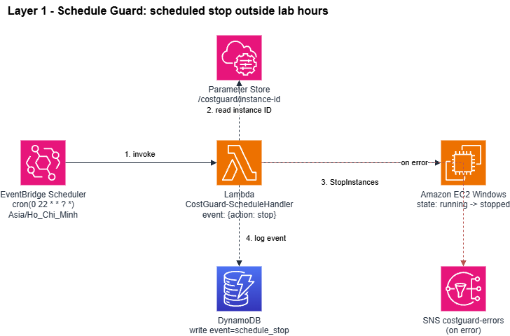
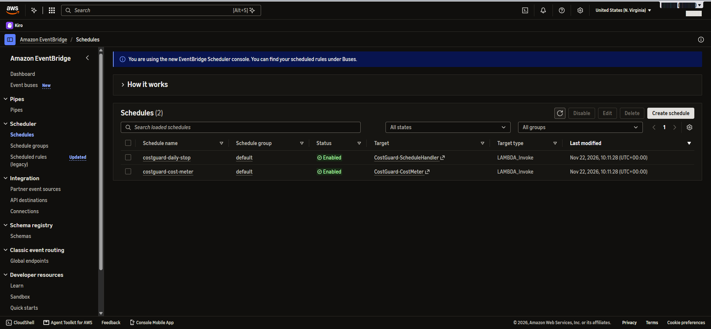
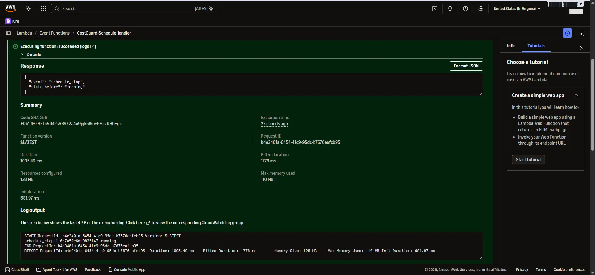
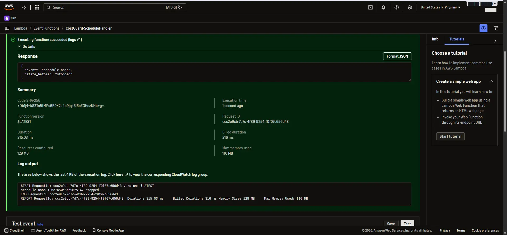
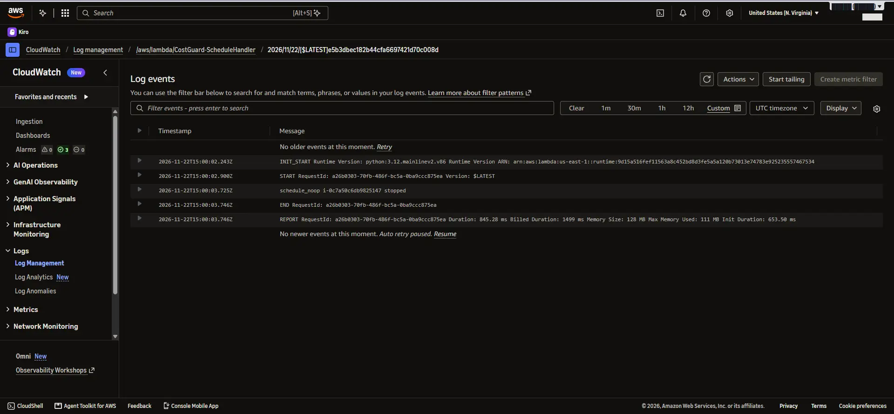
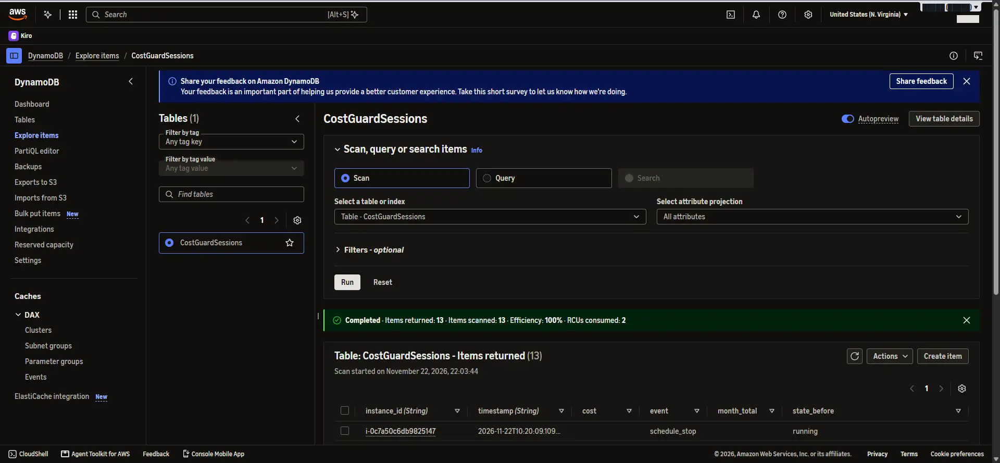

## Lớp 1 – Schedule Guard

Lớp 1 tắt máy lab vào một giờ cố định mỗi ngày. Lớp này không phụ thuộc dữ liệu chi phí hay billing nên chạy ổn định nhất trong ba lớp.



### Cách hoạt động

1. **EventBridge Scheduler** gọi hàm Lambda `CostGuard-ScheduleHandler` mỗi ngày lúc 22:00 (múi giờ `Asia/Ho_Chi_Minh`), với sự kiện `{"action": "stop"}`.
2. Hàm đọc instance ID từ `/costguard/instance-id`.
3. Hàm gọi `DescribeInstances`. Instance đang `running` thì gọi `StopInstances`, còn ở trạng thái khác thì bỏ qua. Nhờ vậy gọi lặp lại nhiều lần vẫn an toàn.
4. Hàm ghi một bản ghi vào `CostGuardSessions` (`schedule_stop` hoặc `schedule_noop`).
5. Gặp lỗi thì hàm gửi lỗi tới `costguard-errors` rồi ném lại lỗi để CloudWatch alarm ở 5.6 bắt được.

Lịch chỉ **tắt** máy, còn bật máy vẫn làm tay. Không ai dùng lab thì không tốn credit.

### Vì sao dùng EventBridge Scheduler

**Rule** của EventBridge hiểu biểu thức cron theo UTC, nên muốn dừng lúc 22:00 giờ Việt Nam phải viết thành 15:00. EventBridge Scheduler cho khai báo múi giờ, nên biểu thức bên dưới đọc sao hiểu vậy. Scheduler cũng gọi hàm qua role riêng, hàm không cần thêm resource-based permission.

```yaml
StopSchedule:
  Type: AWS::Scheduler::Schedule
  Properties:
    Name: costguard-daily-stop
    ScheduleExpression: !Ref StopCron                       # mặc định cron(0 22 * * ? *)
    ScheduleExpressionTimezone: !Ref StopScheduleTimezone   # mặc định Asia/Ho_Chi_Minh
    FlexibleTimeWindow:
      Mode: "OFF"
    Target:
      Arn: !GetAtt ScheduleHandlerFunction.Arn
      RoleArn: !GetAtt SchedulerRole.Arn
      Input: '{"action": "stop"}'
```

### Bước 1 – Xem lịch

1. Mở **EventBridge → Scheduler → Schedules** và chọn `costguard-daily-stop`.
2. Kiểm tra biểu thức cron, múi giờ và target `CostGuard-ScheduleHandler`.



**Kiểm tra:** `costguard-daily-stop` và `costguard-cost-meter` đều ở trạng thái **Enabled**. Mở `costguard-daily-stop` để thấy biểu thức `cron(0 22 * * ? *)`, múi giờ `Asia/Ho_Chi_Minh` và target `CostGuard-ScheduleHandler`.

### Bước 2 – Kiểm thử hàm

1. Kiểm tra instance đang **running** trên console EC2.
2. Mở **Lambda → CostGuard-ScheduleHandler → Test**. Tạo test event `{}` rồi chọn **Test**.
3. Mở console **EC2** và refresh.
4. Mở **DynamoDB → Tables → CostGuardSessions → Explore table items**.

**Kết quả trả về:** hàm trả về `schedule_stop` với `state_before` là `running`. Instance chuyển từ `stopping` sang `stopped`. Bảng có thêm một bản ghi với `event = schedule_stop`.



**Kiểm tra:** lần test có trạng thái **Succeeded**, kết quả trả về có `schedule_stop` và `state_before` là `running`.

Chạy test thêm lần nữa khi instance đã tắt. **Kết quả trả về:** hàm trả về `schedule_noop` và không động tới instance.



**Kiểm tra:** lần này kết quả là `schedule_noop`, `state_before` là `stopped`. Hàm không gọi lại `StopInstances`.

### Bước 3 – Kiểm thử lịch thật (tùy chọn)

1. Bật lại instance.
2. Mở **CloudFormation → CostGuard → Update**, giữ template cũ, đổi `StopCron` sang vài phút sau giờ hiện tại, ví dụ `cron(25 15 * * ? *)` để chạy lúc 15:25 giờ Việt Nam.
3. Đợi tới giờ đó rồi xem trạng thái instance.
4. Update stack lần nữa để trả về `cron(0 22 * * ? *)`.

**Kết quả trả về:** instance dừng đúng giờ đã đặt theo giờ Việt Nam, không bị lệch bảy tiếng.

Nhóm không đổi `StopCron` mà kiểm tra luôn lần chạy 22:00 thật ngày 22/11/2026. Lịch gọi hàm lúc 15:00:02 UTC (22:00 giờ Việt Nam). Lúc đó máy đã tắt sẵn nên hàm chỉ ghi `schedule_noop`.



**Kiểm tra:** log có lần gọi lúc 15:00 UTC (22:00 giờ Việt Nam) và dòng `schedule_noop` kèm instance ID.



**Kiểm tra:** có bản ghi mới với `event = schedule_noop` và `timestamp` trùng giờ chạy của lịch.

Trong phần này, bạn đã xem lịch `costguard-daily-stop` chạy lúc 22:00 giờ Việt Nam bằng EventBridge Scheduler và kiểm thử hàm `CostGuard-ScheduleHandler`. Khi máy đang chạy, hàm dừng máy và ghi `schedule_stop`; khi máy đã tắt, hàm chỉ ghi `schedule_noop`. Lớp 1 tắt máy vào giờ cố định và không cần dữ liệu billing.
