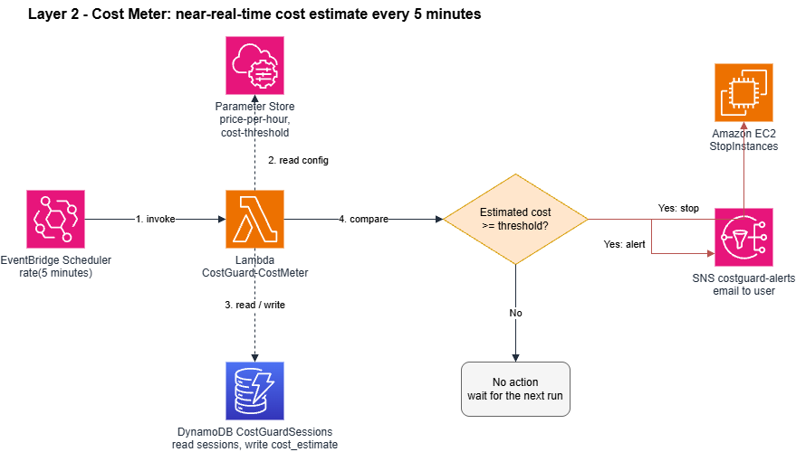
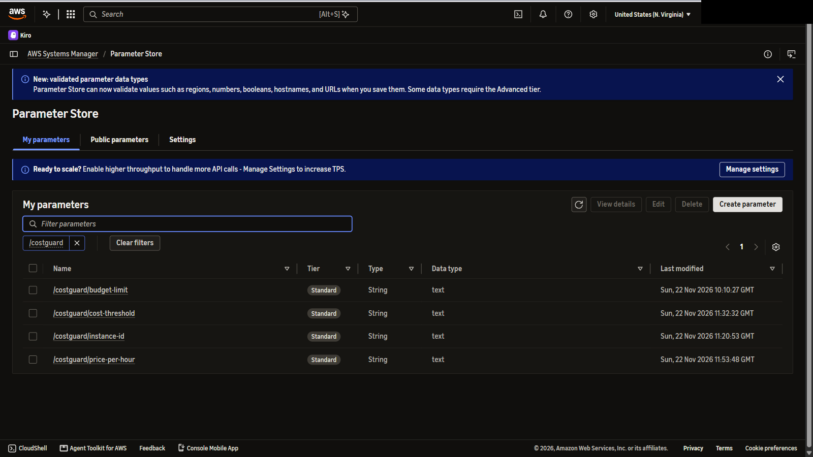
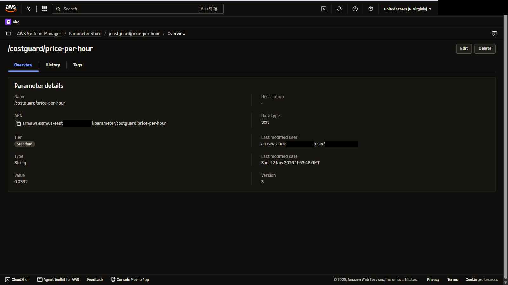
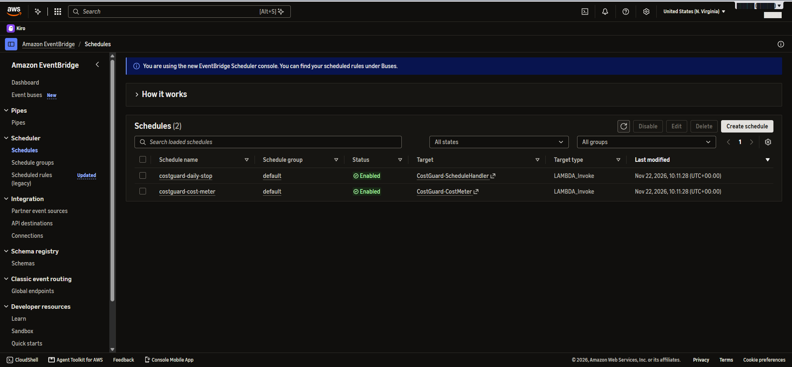
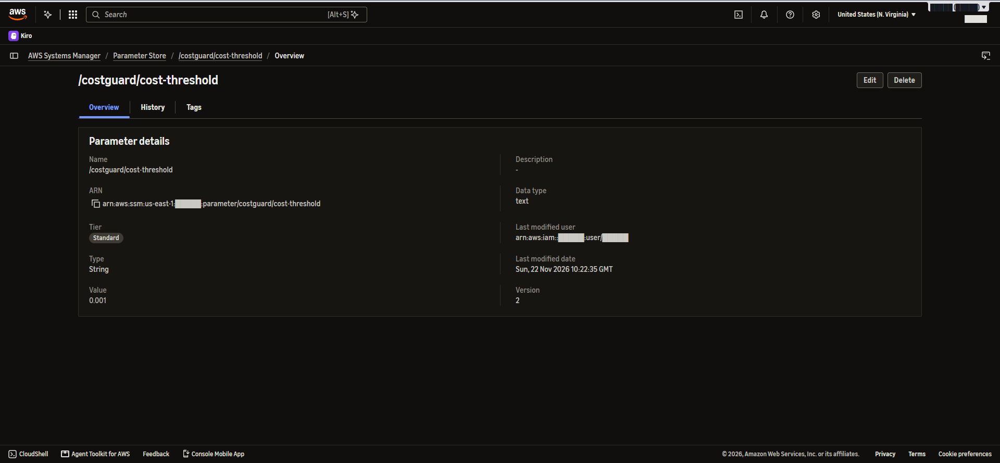
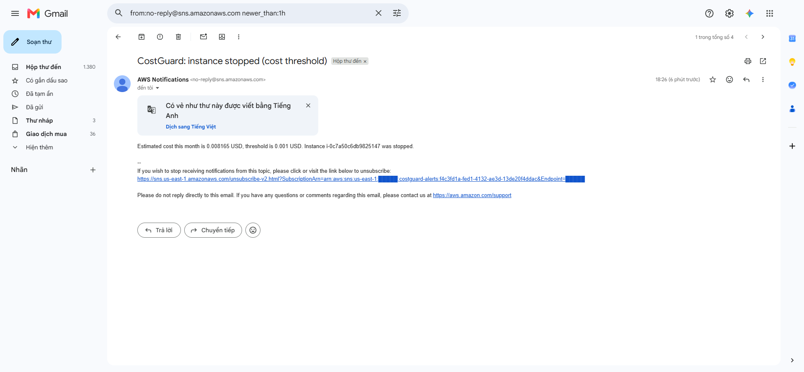
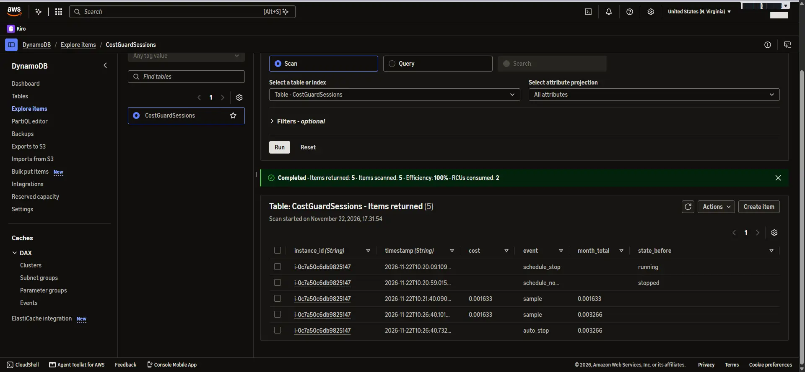
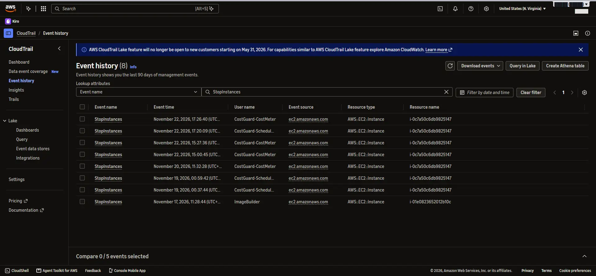

## Lớp 2 – Cost Meter

Lớp 2 ước tính tiền máy lab đã tiêu trong tháng và tắt máy khi chạm ngưỡng. Lớp này dựa vào thời gian chạy của instance và đơn giá theo giờ đã cấu hình chứ không chờ dữ liệu billing, nên phản ứng chỉ trong vài phút. Đây là phần đóng góp riêng của dự án.



### Cách hoạt động

1. **EventBridge Scheduler** gọi `CostGuard-CostMeter` mỗi 5 phút (`rate(5 minutes)`).
2. Hàm đọc instance ID, đơn giá theo giờ và ngưỡng từ Parameter Store.
3. Instance **không chạy** thì hàm dừng ở đây.
4. Instance đang chạy thì hàm tính chi phí cho chu kỳ này:

   ```text
   chi phí mỗi lần = đơn giá theo giờ × 5 ÷ 60
   ```

   Với $0.0392 mỗi giờ, mỗi lần chạy cộng thêm khoảng $0.0033.
5. Hàm đọc toàn bộ bản ghi `sample` trong tháng dương lịch hiện tại (UTC) ở `CostGuardSessions` rồi cộng lại thành tổng của tháng.
6. Hàm ghi thêm một bản ghi `sample` gồm chi phí lần này và tổng mới của tháng.
7. Tổng chạm ngưỡng thì hàm tắt instance, ghi bản ghi `auto_stop` và gửi cảnh báo tới `costguard-alerts`.

**Ngưỡng tính những gì.** Con số ước tính chỉ gồm chi phí chạy EC2. Ổ EBS ($2.40 mỗi tháng) là chi phí cố định, đã tính riêng trong ngân sách.

**Sau khi tự tắt.** Tổng của tháng vẫn đang trên ngưỡng, nên nếu bật lại máy thì lần chạy kế tiếp (trong vòng 5 phút) sẽ tắt nó lần nữa. Máy bị khóa tới tháng dương lịch sau. Credit được giữ an toàn, đổi lại lab không dùng được trong phần còn lại của tháng.

**Hạn chế đã biết.** Phiên chạy ngắn hơn một chu kỳ có thể bị bỏ sót. Tháng mới bắt đầu lúc nửa đêm UTC, tức 07:00 giờ Việt Nam.

### Bước 1 – Xem cấu hình

1. Mở **Systems Manager → Parameter Store**, xem `/costguard/price-per-hour` (0.0392) và `/costguard/cost-threshold` (14).
2. Mở **EventBridge → Scheduler → Schedules**, kiểm tra `costguard-cost-meter` đang bật và dùng `rate(5 minutes)`.



**Kiểm tra:** có đủ bốn tham số `budget-limit`, `cost-threshold`, `instance-id` và `price-per-hour`, tier **Standard** (không tốn phí).



**Kiểm tra:** Value là `0.0392`. Mở `/costguard/cost-threshold` tương tự, Value phải là `14`.



**Kiểm tra:** `costguard-cost-meter` ở trạng thái **Enabled**. Mở lịch này để thấy biểu thức `rate(5 minutes)` và target `CostGuard-CostMeter`.

### Bước 2 – Kiểm thử ngưỡng

Không cần chờ tới ngưỡng thật $14. Chỉ cần hạ ngưỡng xuống để lần chạy kế tiếp vượt qua.

1. Bật instance, chờ tới khi `running`.
2. Mở **Parameter Store → `/costguard/cost-threshold` → Edit**, đổi giá trị thành `0.001`. Ghi lại giờ lúc lưu.
3. Chờ lần chạy kế tiếp, tối đa 5 phút.
4. Kiểm tra console **EC2**, hộp thư và bảng DynamoDB.
5. **Trả ngưỡng về `14`.** Không update CloudFormation stack trong lúc test, vì làm vậy giá trị cũng bị ghi đè.

**Kết quả trả về:** instance chuyển sang `stopping` rồi `stopped`. Hộp thư nhận email "CostGuard: instance stopped (cost threshold)". Bảng có bản ghi `sample` và bản ghi `auto_stop`.



**Kiểm tra:** Value đã thành `0.001`. Ghi lại giờ lưu để dùng ở Bước 3.



**Kiểm tra:** thư có tiêu đề "CostGuard: instance stopped (cost threshold)", gửi tới hộp thư đã đăng ký ở 5.3.



**Kiểm tra:** có các bản ghi `event = sample` (mỗi lần chạy một bản ghi) và một bản ghi `event = auto_stop` ngay sau lần vượt ngưỡng.

### Bước 3 – Đo thời gian phản ứng

Dự án đặt mục tiêu phản ứng dưới 5 phút, tức trong một chu kỳ của bộ đo.

1. Lấy giờ đã lưu ngưỡng mới ở Bước 2.
2. Mở **CloudTrail → Event history**, lọc tên sự kiện `StopInstances` và xem giờ của sự kiện.
3. Lấy hai mốc trừ nhau là ra thời gian phản ứng của lần test này.

**Kết quả trả về:** khoảng cách không vượt quá một chu kỳ của bộ đo. Ghi lại số đo thật của lần chạy.

Ở lần chạy của nhóm, ngưỡng lưu lúc 17:22:53, CloudTrail ghi `CostGuard-CostMeter` gọi `StopInstances` lúc 17:26:40. Thời gian phản ứng là 3 phút 47 giây.



**Kiểm tra:** sự kiện `StopInstances` do `CostGuard-CostMeter` gọi, và Event time cách giờ lưu ngưỡng không quá 5 phút.

Trong phần này, bạn đã kiểm tra `CostGuard-CostMeter` chạy mỗi 5 phút, hạ ngưỡng xuống `0.001` để ép máy tắt, và đo thời gian phản ứng bằng CloudTrail: 3 phút 47 giây ở lần chạy của nhóm, nằm trong một chu kỳ 5 phút. Lớp 2 phản ứng trong vài phút vì không phải chờ dữ liệu billing.
