## Lớp 3 – Budget Backstop và giám sát

Lớp 3 là lưới an toàn cuối cùng. Lớp này bám theo **chi tiêu thực** của tài khoản nên phản ứng chậm, vì dữ liệu billing chỉ cập nhật vài lần mỗi ngày. Phần này cũng giới thiệu các CloudWatch alarm, dùng để báo khi một trong ba hàm bị lỗi.

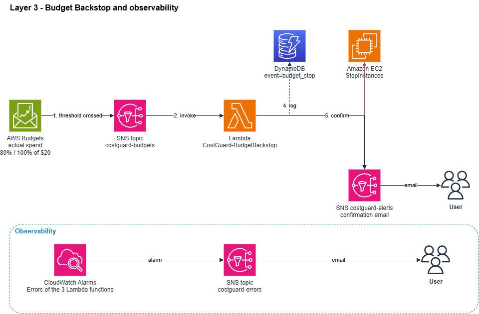

### Cách hoạt động

1. **AWS Budgets** theo dõi chi phí hằng tháng của tài khoản so với hạn mức $20 (`CostGuard-Budget`).
2. Khi chi phí thực vượt **80%** và vượt **100%** hạn mức, Budgets gửi thông báo tới SNS topic `costguard-budgets` và gửi email cho bạn.
3. Topic gọi hàm Lambda `CostGuard-BudgetBackstop`.
4. Hàm dừng instance nếu đang chạy, ghi `budget_stop` (hoặc `budget_noop`) vào `CostGuardSessions` và gửi xác nhận tới `costguard-alerts`.

### Ba lớp phối hợp thế nào

- Lớp 1 dừng máy vào giờ cố định.
- Lớp 2 dừng máy trong vài phút khi chi phí ước tính chạm ngưỡng.
- Lớp 3 dừng máy khi hóa đơn thật tiến gần hạn mức.

Lớp nào cũng dừng được máy nhưng không lớp nào bật máy lên, còn dừng một máy đã tắt thì chẳng ảnh hưởng gì. Nhờ vậy ba lớp không giẫm chân nhau, và nếu một lớp hỏng thì hai lớp kia vẫn chạy bình thường.

### Bước 1 – Xem budget

1. Mở **Billing and Cost Management → Budgets** và chọn `CostGuard-Budget`.
2. Kiểm tra hạn mức hằng tháng và hai cảnh báo (80% và 100%, chi phí thực).

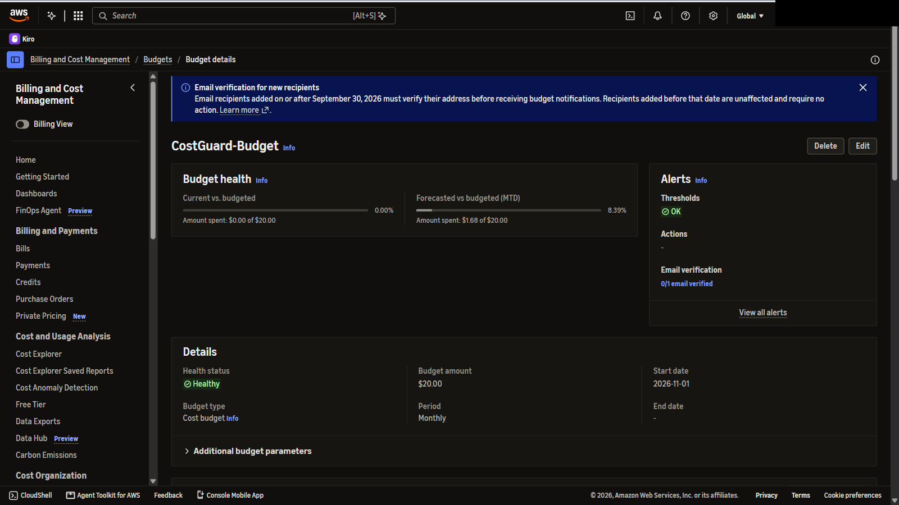

**Kiểm tra:** Budget amount là `$20.00`, Period là **Monthly** và Health status là **Healthy**.

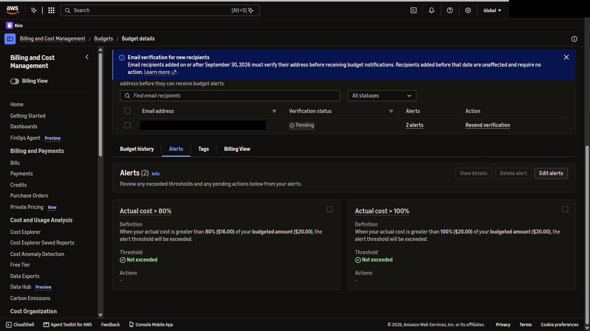

**Kiểm tra:** có đúng hai cảnh báo theo chi phí thực, ở mốc 80% ($16.00) và 100% ($20.00). Mục **Email verification** phải là đã xác minh; nếu email còn **Pending**, chọn **Resend verification** và xác nhận trong hộp thư, nếu không Budgets sẽ không gửi email.

### Bước 2 – Kiểm thử Budget Backstop

Không cần chờ hóa đơn thật tăng. Chỉ cần tự gửi một tin nhắn lên topic.

1. Bật instance và chờ đến khi `running`.
2. Mở **SNS → Topics → `costguard-budgets` → Publish message**. Dùng tiêu đề và nội dung bất kỳ, rồi chọn **Publish message**.
3. Kiểm tra console **EC2**, hộp thư và bảng DynamoDB.

**Kết quả trả về:** instance chuyển sang `stopping` rồi `stopped`. Bạn nhận email "CostGuard: budget notification handled". Bảng có một bản ghi với `event = budget_stop`.

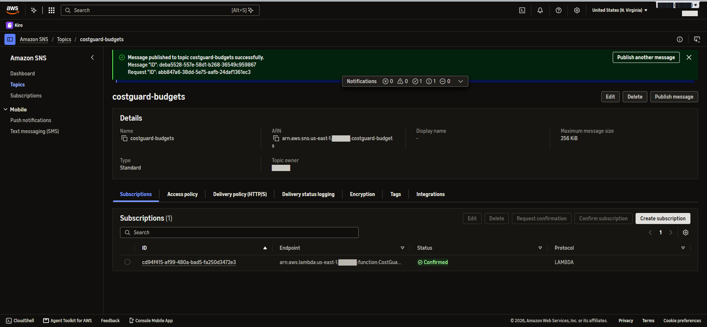

**Kiểm tra:** console báo tin đã được gửi thành công và hiện Message ID.

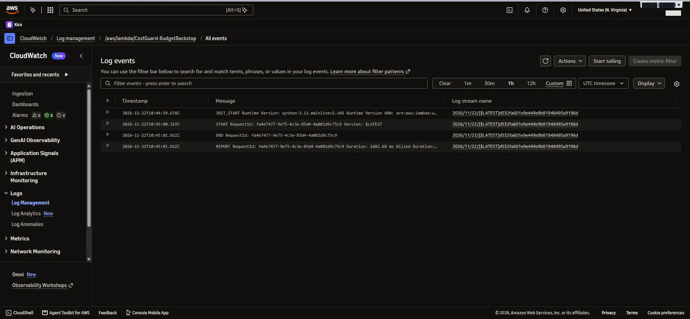

**Kiểm tra:** có một lần gọi hàm (dòng `START`, `END`, `REPORT`) ngay sau giờ gửi tin và không có dòng `ERROR`.

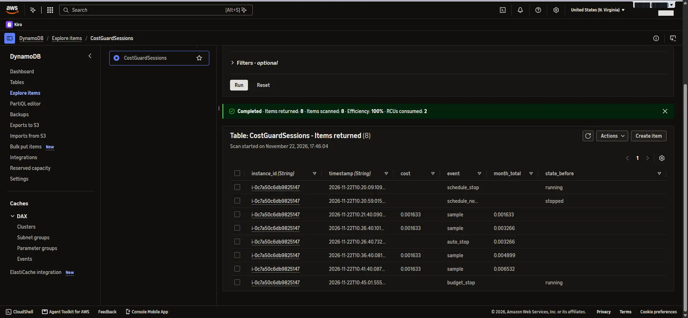

**Kiểm tra:** có bản ghi mới với `event = budget_stop`.

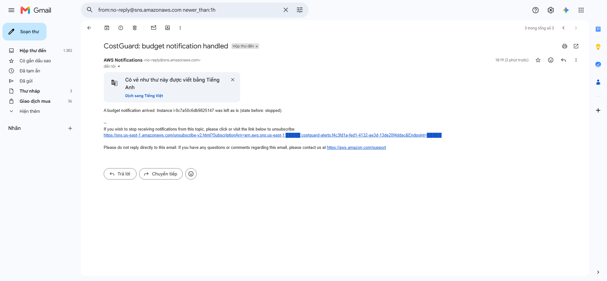

**Kiểm tra:** thư có tiêu đề "CostGuard: budget notification handled".

### Bước 3 – Xem các alarm

1. Mở **CloudWatch → Alarms**.
2. Bạn thấy ba alarm: `CostGuard-ScheduleHandler-Errors`, `CostGuard-CostMeter-Errors` và `CostGuard-BudgetBackstop-Errors`. Mỗi alarm theo dõi chỉ số `Errors` của hàm tương ứng và gửi tin tới `costguard-errors` khi chỉ số lớn hơn 0.
3. Mở **CloudWatch → Log groups**. Ba log group `/aws/lambda/CostGuard-*` giữ log trong 14 ngày.

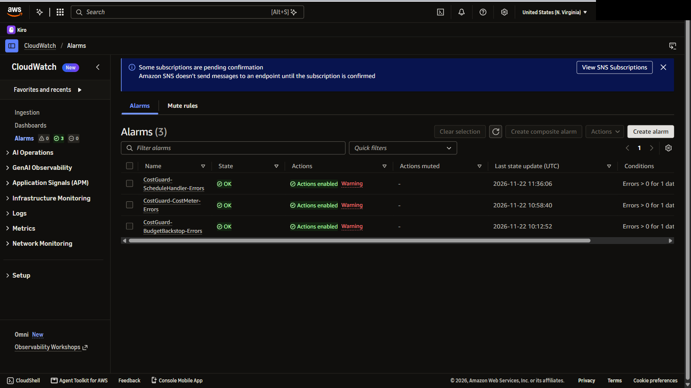

**Kiểm tra:** có đủ ba alarm, State là **OK**, Actions là **Actions enabled** và điều kiện là `Errors > 0`.

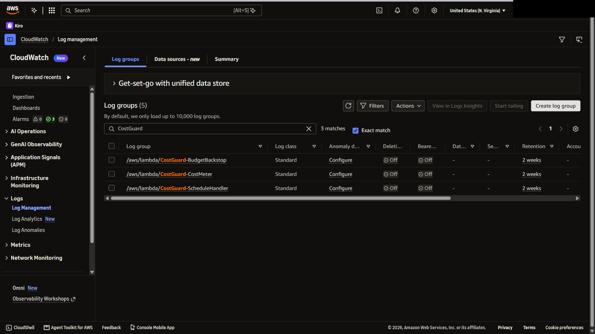

**Kiểm tra:** cột Retention là **2 weeks** (14 ngày) cho cả ba log group.

### Bước 4 – Kiểm thử kịch bản lỗi

Ở bài thử này, ta cố tình cho `CostGuard-CostMeter` lỗi để xem alarm và email có báo đúng không.

1. Mở **Parameter Store → `/costguard/instance-id` → Edit**. Ghi lại instance ID thật trước, rồi thay giá trị bằng `i-00000000000000000`.
2. Chờ tối đa 10 phút. Hàm chạy mỗi 5 phút và alarm dùng chu kỳ 5 phút.
3. Kiểm tra log của `CostGuard-CostMeter`, trạng thái alarm và hộp thư.
4. **Đặt lại instance ID thật.**

**Kết quả trả về:** hàm báo lỗi, email từ `costguard-errors` gửi về hộp thư, và alarm `CostGuard-CostMeter-Errors` chuyển sang **In alarm**. Khôi phục ID xong, đợi lần chạy kế tiếp thành công thì alarm về lại **OK**.

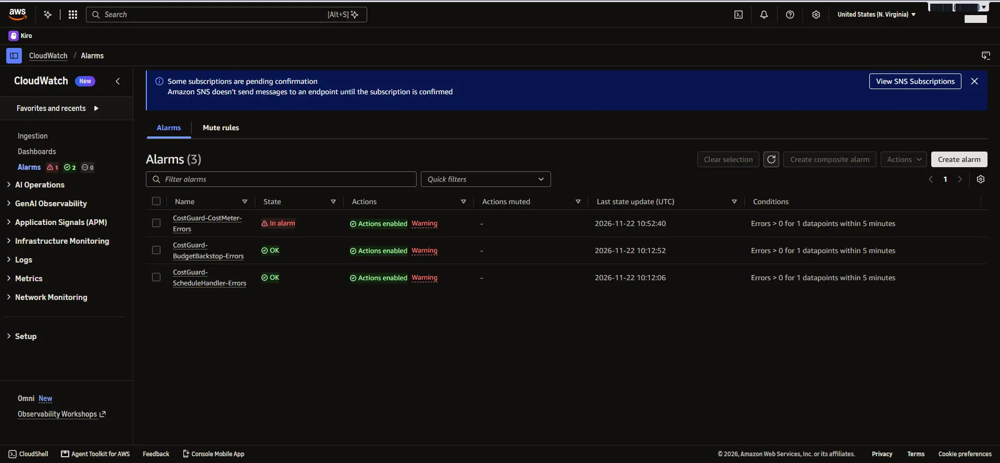

**Kiểm tra:** State là **In alarm** sau lần chạy lỗi của hàm.

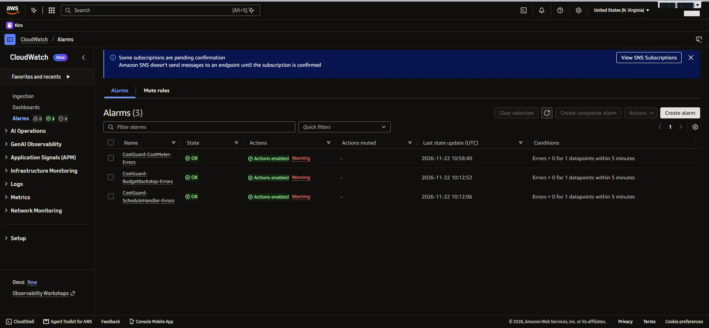

**Kiểm tra:** State trở lại **OK** sau lần chạy thành công kế tiếp.

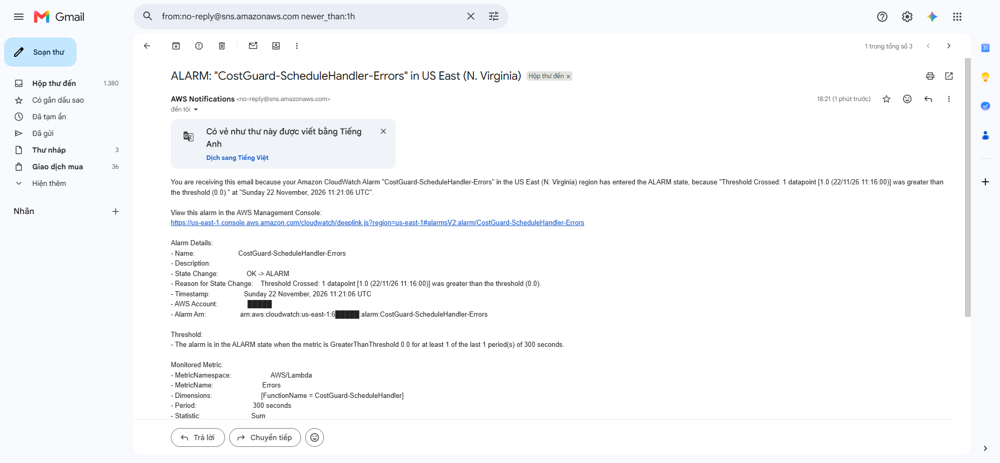

**Kiểm tra:** thư có tiêu đề bắt đầu bằng `ALARM:` và tên alarm bị kích hoạt.

Trong phần này, bạn đã xem AWS Budget `CostGuard-Budget` ($20, cảnh báo ở 80% và 100%), kiểm thử `CostGuard-BudgetBackstop` bằng cách gửi tin lên topic `costguard-budgets`, và thử ba alarm lỗi bằng cách cố tình làm `CostGuard-CostMeter` lỗi. Cả ba lớp giờ đều đã được kiểm thử, và bạn được báo khi một lớp bị hỏng.
