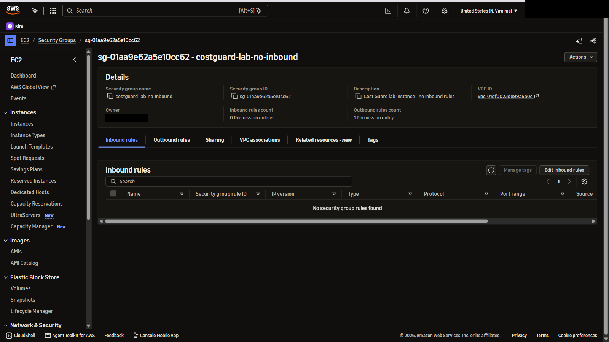
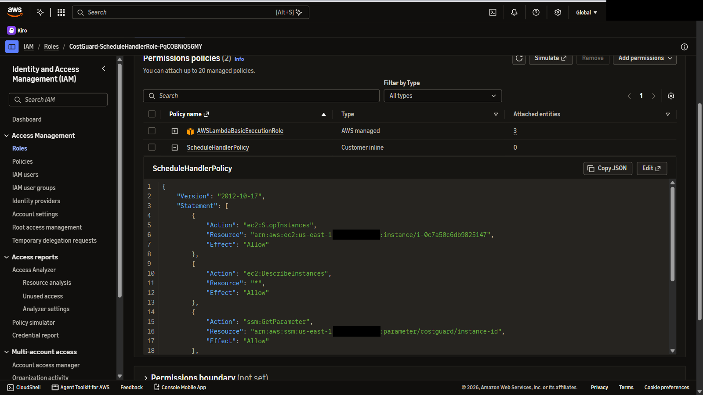
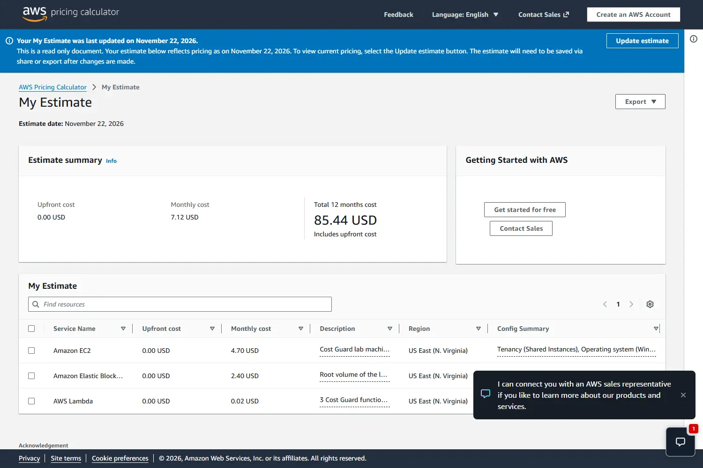

## Rà soát bảo mật và chi phí

Phần này xem lại cách Cost Guard lo phần bảo mật, chi phí dự kiến và các cách giữ chi phí thấp.

### 1. Bảo mật

**Mỗi hàm một IAM role.** Ba hàm Lambda dùng ba role riêng, nên hàm này có lỗi cũng không mượn được quyền của hàm khác. Quyền dừng instance chỉ áp dụng cho **ARN của instance cần bảo vệ**:

```json
{
  "Effect": "Allow",
  "Action": "ec2:StopInstances",
  "Resource": "arn:aws:ec2:us-east-1:<account-id>:instance/<instance-id>"
}
```

Riêng `ec2:DescribeInstances` phải cấp trên mọi tài nguyên, vì action này không hỗ trợ giới hạn theo tài nguyên. Các quyền còn lại chỉ áp dụng cho đúng tham số, bảng và topic mà từng hàm dùng.

**Không có thông tin xác thực trong code.** Các hàm dùng execution role. Giá trị trong Parameter Store chỉ gồm đơn giá theo giờ, ngưỡng, hạn mức ngân sách và instance ID.

**Các dịch vụ gọi nhau bằng role riêng.** EventBridge Scheduler dùng một role chỉ gọi được hai hàm. Topic policy của `costguard-budgets` chỉ cho dịch vụ Budgets của chính tài khoản bạn gửi tin.

**Không mở cổng nào.** Máy lab trong workshop dùng security group riêng `costguard-lab-no-inbound`, không có inbound rule nào, và bắt buộc IMDSv2. Nếu để template tự tạo máy thì máy sẽ nhận security group mặc định của default VPC, group này chỉ cho các máy cùng group kết nối với nhau.



**Kiểm tra:** mở **EC2 → Security Groups → `costguard-lab-no-inbound`**. Inbound rules count là **0 Permission entries** và tab **Inbound rules** ghi "No security group rules found".

**Cách kiểm tra:** mở **IAM → Roles**, mở từng role `CostGuard` và đọc policy. Action duy nhất làm thay đổi trạng thái EC2 là `StopInstances`, và chỉ trên một instance.



**Kiểm tra:** `ec2:StopInstances` có Resource là ARN của đúng một instance, `ec2:DescribeInstances` là `*`, và `ssm:GetParameter` chỉ trên `/costguard/instance-id`. Hai role còn lại đọc theo cách tương tự.

### 2. Dự toán chi phí

Dự toán được lập bằng AWS Pricing Calculator cho US East (N. Virginia), giá on-demand và 120 giờ lab mỗi tháng. Giá tính không có Free Tier.

- Amazon EC2 Windows (t3.small): 120 giờ × $0.0392 = **$4.70**
- Amazon EBS (gp3, 30 GB): **$2.40**, tính cả tháng kể cả khi máy tắt
- Địa chỉ Public IPv4: 120 giờ × $0.005 = **$0.60**
- AWS Lambda: khoảng **$0.02**
- Amazon DynamoDB (on-demand): khoảng **$0.002**
- Amazon CloudWatch (3 alarm và log): khoảng **$0.31**
- EventBridge Scheduler và Amazon SNS: mỗi dịch vụ dưới **$0.01**

Các dịch vụ có trong Calculator (EC2, EBS và Lambda) cộng lại **$7.12 mỗi tháng** ([bản ước tính](https://calculator.aws/#/estimate?id=641acc2f03b075415ec10d1ab0de1590ab659dd9)). Cộng thêm các dịch vụ còn lại thì tổng khoảng **$8.05 mỗi tháng**, vẫn dưới ngân sách $20. Nếu để máy đó chạy 24/7 thì tốn khoảng $31.04 mỗi tháng, tức Cost Guard tiết kiệm được khoảng $23.92 mỗi tháng.



**Kiểm tra:** Monthly cost là **7.12 USD**, gồm Amazon EC2 4.70 USD, Amazon EBS 2.40 USD và AWS Lambda 0.02 USD, Region US East (N. Virginia).

### 3. Tối ưu chi phí

- Giới hạn giờ chạy. Lịch dừng và việc bật máy thủ công giữ máy ở gần 120 giờ thay vì 730.
- Dùng các dịch vụ trả theo lượt dùng và nằm trong hạn mức miễn phí: Lambda, DynamoDB on-demand, SNS và EventBridge Scheduler.
- Dùng tham số standard của Parameter Store, không tốn phí.
- Giữ ổ gp3 30 GB và không thêm IOPS hay throughput.
- Không gắn Elastic IP, vì bị tính phí khi đang được cấp phát.
- Xóa toàn bộ tài nguyên sau workshop (xem 5.8).

Trong phần này, bạn đã rà soát bảo mật của Cost Guard (mỗi hàm một IAM role, `StopInstances` chỉ áp dụng cho một instance, không mở cổng inbound), dự toán khoảng $7.12 mỗi tháng cho 120 giờ lab so với $31.04 nếu chạy 24/7, và các cách giữ chi phí thấp.
